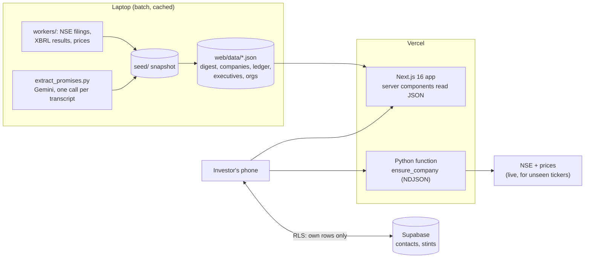

# FINN — a memory that argues back

**FINN (Financial Investment Agent)** tells an investor what changed in their portfolio, whether it
breaks the reason they own the stock, what to ask next, and who in their own network could answer.

**Live:** https://assignment1-eta-dun.vercel.app · mobile-first, no login.
Built for the ENAM Founding AI Engineer Build Challenge (Push · Pull · Network).

> The plan this was built from is in [`docs/design-v2.md`](docs/design-v2.md) and
> [`docs/FRONTEND.md`](docs/FRONTEND.md). This README describes **what actually exists**, and
> §9 lists every place where the build differs from the plan.

---

## 1. Two minutes on a phone

1. **Today** opens on a replay of the morning of **6 Nov 2026, 08:00 IST**, the day after the busiest
   filing day in the snapshot: `28 filings · 5 need you`. Each card leads with a verdict built from the
   numbers ("Revenue down 31.0% YoY; profit after tax up 73.7%"); every figure is tappable to its NSE
   XBRL source or its formula. Routine filings are folded and counted; the brief ends.
2. Tap **›** to **7 Nov**: Voltas names **Jayant Balan** as its next Managing Director. The card shows his
   career from the filing's own brief profile, and the path **You → Rohan M. → Jayant Balan**
   ("overlapped at Voltbek Home Appliances, 2019–2022"). Tap Rohan for a call sheet: why him, when you
   last spoke, three questions, a draft opener you send yourself.
3. **Portfolio → Aurobindo Pharma**: in Feb 2026 the CFO guided an FY26 EBITDA margin of 20–21%
   (transcript page 7); the four reported FY26 quarters give **20.23% — delivered**. The FY27 "north of
   21%" target is **at risk** at 20.79% year to date. Tap any promise for the verbatim quote.
4. **Ask → "Dixon Technologies"** (not in the portfolio): a live checklist reads a year of prices and five
   quarters of results straight from NSE in about 3 seconds. **Who knows… → "Jayant Balan"** ranks your
   contacts.

## 2. Point of view

An investor does not want a feed; they want to know **whether their reason for owning a stock is still
true**, and if not, what to ask and whom. So FINN is organised around beliefs and evidence:

- **Finite, not infinite.** At most five cards need you; everything else is folded and counted. The
  brief ends with "That's everything that matters today."
- **Verdict first, evidence on tap.** Numbers go through one component (`Num`) that formats them and
  opens their source or formula. Every block carries an epistemic tag: Said, Extracted, Calculated,
  FINN's read, Unknown.
- **People where they help.** There is no Network tab: a person and a reason sit at the bottom of every
  card, and on every Company page.

## 3. What is built

| Layer | Working workflow | Real data behind it |
|---|---|---|
| **Push** | Daily brief with replay (any day 31 Oct–15 Nov), 24h / 7-day windows, scored and bucketed cards, folded routine filings, reading-time estimate with its formula | 11,147 NSE announcements (251 for the portfolio), 1 year of prices, 21 of 22 companies' Q2 FY27 results parsed from XBRL |
| **Push → Network** | Management-change card with the appointee's career from the filing, second-degree path, call sheet | Voltas Reg. 30 filing (brief profile + Annexure A); 28 synthetic contacts |
| **Pull** | Company page: credibility line, thesis strip, promise timeline (said → deadline), quote sheet, 7-quarter snapshot, next question with people | Promise Ledger: 30 verified promises from 9 of 12 transcripts (Aurobindo, M&M, Voltas) |
| **Pull, any ticker** | Ask: search 2,635 NSE symbols; unseen companies processed live by a Python function | NSE integrated-filing XBRL + prices, from Vercel's servers |
| **Network** | Who to ask on every card and Company page; "Who knows…" search; keep-warm nudges | Matching runs in the browser over the investor's own rows |

Portfolio: 18 non-financial NSE companies across autos, pharma, healthcare, capital goods, defence,
construction, power, chemicals, consumer and IT, chosen because they reported July–September results in
the two weeks before the snapshot. Lenders are excluded (EBITDA is not meaningful for banks); an
unseen bank in Ask gets prices only, with that reason shown.

## 4. Architecture



**Decisions that matter**

1. **Compute once, read many.** Everything derived from public data is computed in batch on a laptop and
   committed as JSON. Screens are mostly reads: the Portfolio and Company pages are prerendered server
   components, so their data never ships to the browser.
2. **Deterministic before probabilistic.** Numbers come from XBRL and Python; filing categories from rules;
   triage scores, overlap strengths and promise statuses from formulas with stated reasons. A model is used
   in exactly one place: finding promises in transcripts.
3. **The network never leaves the investor.** Contacts live in Supabase behind row-level security;
   matching runs in the browser; explanations, questions and openers are templates.
4. **Snapshot first, live where it matters.** The demo never depends on a live source, except Ask for an
   unseen ticker, which degrades to a reduced view instead of an error.

### Data pipelines

| Source | How | Stored as |
|---|---|---|
| NSE corporate announcements | `/api/corporate-announcements` JSON, fetched from a laptop, 14-day window, raw feed kept | `seed/filings/*.json` → `web/data/digest.json` |
| Quarterly results | NSE `/api/integrated-filing-results` → Ind AS XBRL, parsed deterministically (`workers/parsers/xbrl_results.py`) | `seed/facts.csv`, `seed/results.json` |
| Prices | yfinance (batch); Yahoo chart endpoint via `httpx` (live function) | `seed/prices.csv` |
| Transcripts | Earnings-call transcripts **filed with NSE** (not screener.in: one primary source, no scraping terms) | PDFs local only; promises in `seed/promises.json` |
| Executives | The appointment filing's brief profile; stints transcribed with the source sentence | `web/data/executives.json` |
| Network | Synthetic CSV → SQL template → copied per visitor | Supabase `contacts`, `contact_stints` |

**EBITDA**, stated in the UI: profit before exceptional items and tax + finance costs + depreciation −
other income − share of associates *only when it sits inside PBT* (decided per filing by arithmetic).
Starting from profit before exceptional items removes one-offs without guessing their sign.

### Scoring and the thesis

`score = 0.35·M + 0.25·S + 0.30·T + 0.10·N` (README v2 §6.2), computed in two places:

- **M, S, T in batch.** Materiality by category; surprise from the numbers; **thesis relevance T**:
  1.0 when results contradict a numeric thesis item, 0.7 when they touch one or when a top-management
  change hits a company you hold a thesis on, 0.4 for any other event about a company you own. Buckets
  use `(0.35·M + 0.25·S + 0.30·T) / 0.90`.
- **N on the device.** The network bonus depends on the investor's private contacts, so it is added in
  the browser (N = 1 when a contact's link strength is ≥ 0.5) and only reorders cards within
  "Needs you", so nothing jumps between sections when the network loads.

Thesis items are checked by rules against year-to-date reported numbers (`workers/thesis.py`, shared
by the cards and the Company page). Results cards show the **assumption line** with its stance, a
**promise cross-check** where management guided the same metric for the year (Aurobindo: "Guided at
least 21.0% · so far this year 20.8%"), and a **next question built from the gap** ("Your assumption
'EBITDA margin stays at or above 15% this year' is off track: 13.76% year to date…").
Results, M&A, litigation and pledging are never folded. Moves are "unexplained" only if nothing was
filed between the previous session and the move (weekends count).

## 5. Trust: no invented numbers or quotes

- **Numbers never come from a model.** Checked against the companies' own results PDFs: Lupin 8/8,
  Aurobindo 8/8 line items (PDFs in ₹ million), M&M 6/7 and Tata Power 6/7 (the misses are a tax split
  and Tata Power's regulatory deferral).
- **Every promise quote is checked word for word against the transcript PDF**; the page number is taken
  from where the quote is found, not from the model. Zero quotes have been dropped so far.
- **Headlines are templates over parsed numbers**, not model prose.
- **Honest uncertainty in the UI:** "probable" links, "overlap not confirmed", "Can't check yet" with a
  reason, "numbers not machine-readable" (Deepak Fertilisers filed only a half-year context).

## 6. Security and privacy

| Concern | What exists |
|---|---|
| Isolation | Postgres row-level security on every private table (`user_id = auth.uid()`); tested with two anonymous users: cross-user read, insert, update and delete all blocked (`web/scripts/rls_test.mjs`) |
| Access | No login screen: each visitor gets an anonymous Supabase user and their own copy of the synthetic network |
| Models | No model ever receives network data. The LLM router (`workers/llm.py`) refuses any payload containing network field names. Only public transcripts are sent. |
| Free tier | Gemini's free tier may use submitted content to improve Google's products. Acceptable here only because nothing private is sent; production would use a paid tier. |
| Actions | FINN drafts openers; the investor sends them. Call-sheet questions ask for context, never for unpublished price-sensitive information. |
| Data | Contacts are synthetic (first name + initial, flagged `is_synthetic`). Executives are real people named in public filings; their career data comes only from those filings. |
| Not built yet | Application-level encryption of contact fields, consent flow for imported contacts, retention jobs. |

## 7. Models and cost

| Step | Handler |
|---|---|
| Revenue, EBITDA, PBT, PAT, QoQ/YoY, margins, alerts, scores, overlaps, promise status | Python / TypeScript, no model |
| Filing classification | Rules (17 categories from ENAM's reference) |
| Promise extraction | Gemini, one call per transcript, JSON schema, cached by content hash |

**Routing, as it actually happened:** `gemini-3.5-flash-lite` returned 1 weak promise (and an `Infinity`
target) where `gemini-3.8-flash` found 6 verified ones on the same transcript; 3.8 was too slow
(6–20 min, timeouts), so extraction runs on `gemini-3.6-flash` with 3.8 as fallback.
**Spend: ₹0** (free tier). 12 live calls, about 194k input and 10k output tokens, plus 14 cache hits
(`seed/llm_calls.jsonl`). The free tier's 503/429 limits are why 3 of 12 transcripts are still
missing.

## 8. Cloud

| Part | Where | Why |
|---|---|---|
| Next.js app | Vercel | Prerendered pages, zero config |
| `ensure_company` | Vercel Python function (Vercel Services routes `/api/py/*`) | Same project; no idle sleep; 90 s internal budget |
| Private network | Supabase (Postgres + anonymous auth) | RLS, free tier |
| Ingestion, extraction | Laptop, committed snapshot | Exchange sites and the free model tier are unreliable; the demo must not depend on them |

## 9. Deliberately left out, and differences from the plan

| Item | Status |
|---|---|
| Promise Ledger coverage | 9 of 12 transcripts (free-tier quota stopped the other 3); 26 of 30 promises are segment-level or non-financial, shown as "Can't check yet" with the reason. Segment parsing from XBRL is the next step. |
| Status rule | Strict range check: Aurobindo said "mostly on the **higher** side of 20–21%" and delivered 20.23%, marked Delivered. Qualifiers are shown in the quote, not scored. |
| Bull vs bear, free-text agent | Not built (needs the model; free tier rate-limited) |
| Assumption editor, custom window, WhatsApp share, swipe feedback, service worker, Playwright | Cut for time; demo assumptions are seeded and labelled |
| JS budget | §12 asked for < 150 KB gzipped; the Next 16 + React 19 framework alone is ≈ 152 KB. `/today` is 217 KB, a Company page 190 KB (`web/scripts/js-budget.mjs`) |
| Overlap scoring | TypeScript in the browser instead of SQL, so the network never leaves the device |
| Market caps | Size labels are judgement; the yfinance lookup returned nothing |

## 10. Evaluation (README v2 §16)

Everything below is in `eval/`, reproducible with fixed seeds. Misses are reported, not tuned away.

**Triage** (`eval/triage_results.md`). 40 portfolio filings, sampled across FINN's three buckets with
a fixed seed, shuffled, FINN's verdict and category hidden, labelled by the author ("would I want this
in front of me?"). The weights were fixed before the labels existed.

| FINN's call | Precision | Recall |
|---|---|---|
| Shown (needs you + worth a read) | 0.54 (14/26) | 0.67 (14/21) |
| Needs you only | 0.46 (6/13) | 0.29 (6/21) |

These are the blind figures. After review, US FDA inspection outcomes and other regulator actions were
made material (litigation/regulatory) in `workers/classify.py`. That change was prompted partly by
sample item #33 (Aurobindo's Apitoria Unit 2 VAI, labelled material, previously folded), so the re-run
(`eval/triage_results.md`: shown 0.56 (15/27) precision, 0.71 (15/21) recall; needs-you unchanged) is
no longer blind for that item and is not the headline.

The largest disagreement is about results: the labeller marked all six quarterly-results filings in the
sample as not material, while FINN puts results first (as ENAM's reference does). Several filings the
labeller marked material were folded by FINN: an earnings-call recording, two investor-meeting
schedules, an articles-of-association amendment, a newspaper publication, M&M's results press release
and an Aurobindo plant update (a US FDA inspection outcome, since fixed; see above). Both were clear
FINN misses: press releases score low by category, and a press release *about results* is not grouped
with the results card. With n = 40 and one
labeller, read these as directional.

**Promise extraction** (`eval/promise_spotcheck.csv`). 20 of the 30 promises (fixed seed) checked
field by field against the transcript, by the coding assistant rather than the author:

| Field | Correct |
|---|---|
| Quote is verbatim | 20/20 (enforced in code) |
| Is a measurable management target | 20/20 |
| Target value and unit | 20/20 |
| Scope | 19/20 |
| Metric | 18/20 ("pre-sales" labelled order book; Tech Mahindra's EBIT target labelled EBITDA) |
| Deadline | 16/20 strict, 19/20 lenient (one wrong quarter; three calendar-year targets that straddle two fiscal years) |

**Unseen tickers** (`eval/unseen_tickers.csv`, live Vercel function): Dixon 2.7 s and Polycab 2.3 s
(prices + 5 quarters of XBRL results), HDFC Bank 1.0 s (lender: results skipped by design), an unknown
symbol rejected in 0.5 s.

**Privacy** (`workers/tests/test_privacy.py`): the model router refuses every network field before any
request is made; the extraction prompt contains none; no demo contact's name appears in any logged or
cached model traffic.

## 11. Run it

```bash
# web (Node 20+)
cd web && npm install && npm run dev            # http://localhost:3000
# local Python service for Ask (dev rewrites /api/py/* to it)
python -m venv py/.venv && py/.venv/Scripts/python -m pip install -r py/requirements-dev.txt
py/.venv/Scripts/python -m uvicorn main:app --app-dir py --port 8000
# data pipeline (optional; the snapshot is committed)
python -m venv workers/.venv && workers/.venv/Scripts/python -m pip install -r workers/requirements.txt
workers/.venv/Scripts/python workers/build_digest.py && workers/.venv/Scripts/python workers/build_companies.py
```

Supabase: run `db/migrations/0001_init.sql`, then `db/seed_network.sql`; enable anonymous sign-ins;
put the URL and anon key in `web/.env.local`. Gemini (extraction only): `GEMINI_API_KEY` in `.env.local`.

**Tests:** `workers/.venv/Scripts/python -m pytest workers/tests` (34: parser on a real M&M filing,
EBITDA rules, classifier, alerts, privacy) · `node --test web/scripts/network.test.mjs` (7) ·
`node --test web/scripts/format.test.mjs` (4) · `node --env-file=web/.env.local web/scripts/rls_test.mjs`.

## 12. Next

Segment-level XBRL parsing (unlocks most of the ledger) · finish extraction on a paid tier · lender
results card (NII, PPOP, PAT) · thesis editor with evidence re-check · bull vs bear with citation
enforcement · scheduled ingestion from an Indian-region runner · triage evaluation on labelled filings.

---

*Built with Claude Code as a coding assistant; the full session history is part of the submission.
Network data is synthetic. Every other number comes from NSE filings or end-of-day prices.*
