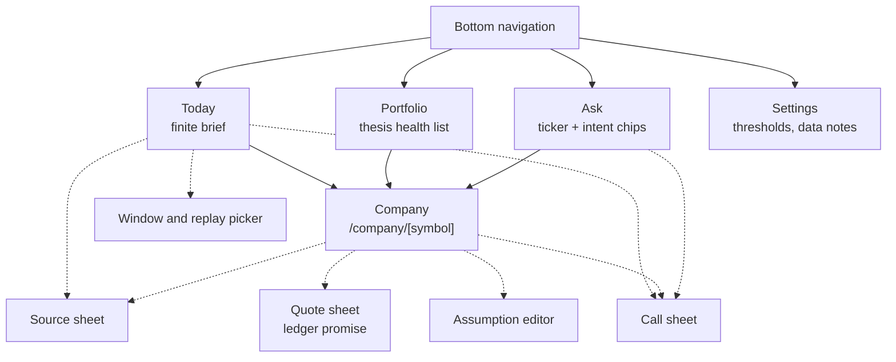
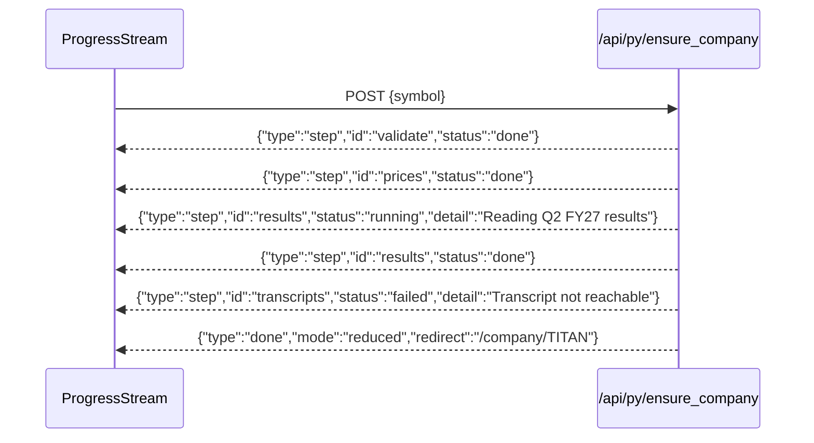

# FINN — Frontend plan

> **Plan, not the current state.** Written before the build; what exists is in the README, and README §9 lists every difference.

Companion to `README.md` (v2). This document specifies everything the investor touches: navigation, screens, components, design system, data contracts, states, performance, and the build order inside the 24-hour plan.

**Design stance in one line:** a newspaper front page that ends, not a trading terminal that scrolls forever. Verdict first, evidence one tap away, one person and one question at the bottom of every card.

---

## Contents

1. [Goals and constraints](#1-goals-and-constraints)
2. [Information architecture](#2-information-architecture)
3. [Routes and URL state](#3-routes-and-url-state)
4. [Design system](#4-design-system)
5. [Screen specifications](#5-screen-specifications)
6. [Component inventory](#6-component-inventory)
7. [Data layer and contracts](#7-data-layer-and-contracts)
8. [Streaming UX](#8-streaming-ux)
9. [Trust UX](#9-trust-ux)
10. [States: loading, empty, partial, error](#10-states-loading-empty-partial-error)
11. [Accessibility](#11-accessibility)
12. [Performance budget](#12-performance-budget)
13. [PWA and demo-proofing](#13-pwa-and-demo-proofing)
14. [Copy guidelines](#14-copy-guidelines)
15. [Folder structure](#15-folder-structure)
16. [Build order (inside the 24-hour plan)](#16-build-order-inside-the-24-hour-plan)
17. [QA checklist](#17-qa-checklist)
18. [Out of scope for the prototype](#18-out-of-scope-for-the-prototype)

---

## 1. Goals and constraints

| Goal | What it means for the frontend |
|---|---|
| Saves time | Today opens directly on ≤ 5 cards. No dashboard to interpret. |
| Shows only what matters | Three tiers: *Needs you*, *Worth a read*, *Collapsed* (counted, expandable). |
| Network woven in | No Network tab. People appear inside cards, the Company screen and Ask results. |
| No AI slop | Every number tappable to its source; every AI sentence carries an epistemic tag; no filler prose. |
| Mobile-first | Designed at **390 × 844** (common phone viewport); works from 360 px; desktop shows the same column centred at max 480 px. |
| Grader-proof | No login, a replay date preset to a busy results day, no blank or error screens. |

**Hard constraints:** one day of build time; free tiers; works over mobile data; no chart library; Next.js App Router on Vercel.

---

## 2. Information architecture



Solid arrows are page navigations; dotted arrows are **bottom sheets** (they keep context, close with a swipe down or the back gesture).

**Why three tabs, not four:** Today (Push), Portfolio (entry to Pull), Ask (Pull on demand, including unseen tickers). Settings is reached from an icon in the Today header, not a tab, because it is rarely used.

---

## 3. Routes and URL state

| Route | Renders | URL parameters |
|---|---|---|
| `/` | Redirects to `/today` | — |
| `/today` | Finite brief | `date` (replay, `YYYY-MM-DD`), `window` (`24h` · `7d` · `custom:<from>..<to>`), `sheet` |
| `/portfolio` | Company list with thesis health | `sort` (`attention` · `name` · `sector`) |
| `/company/[symbol]` | Company detail | `tab` not used (single scroll); `sheet`, `promise`, `assumption` |
| `/ask` | Ticker search and intents | `q` (ticker), `intent` (`promises` · `bullbear` · `who`) |
| `/settings` | Thresholds, alert categories, data and privacy notes | — |

**Rules:**

- **The URL is the state** for window, replay date, open sheet and selected item, so every view can be deep-linked in the writeup and survives refresh.
- Sheets are reflected in `?sheet=source&doc=<id>&page=<n>` or `?sheet=call&event=<id>`; the browser back gesture closes them.
- Replay date default comes from `DEMO_REPLAY_DATE`; a persistent banner shows "Viewing 13 Nov 2026 · replay" with a "Today" reset.

---

## 4. Design system

### 4.1 Principles

1. **Typography carries the hierarchy**, not boxes and colour.
2. **One accent colour** for "needs you" and primary actions. Stance colours (supports / contradicts / unclear) are semantic and always paired with an icon and a word.
3. **Flat surfaces**, hairline borders, no gradients or shadows except the bottom sheet.
4. **Numbers are first-class**: tabular figures, right-aligned in tables, Indian digit grouping.

### 4.2 Tokens

Defined as CSS variables in `app/styles/tokens.css` and mapped into Tailwind's theme. Light and dark mode both supported (`prefers-color-scheme`), because investors read early and late.

| Token | Light | Dark | Use |
|---|---|---|---|
| `--bg` | `#FAFAF7` | `#121211` | Page background (warm off-white: "paper"). |
| `--surface` | `#FFFFFF` | `#1C1C1A` | Cards, sheets. |
| `--ink` | `#1A1A18` | `#ECECE8` | Primary text. |
| `--ink-2` | `#5F5E5A` | `#A8A79F` | Secondary text. |
| `--ink-3` | `#8A8983` | `#7A7973` | Hints, timestamps. |
| `--line` | `#E6E4DD` | `#2C2C29` | Hairlines. |
| `--accent` | `#3C3489` | `#AFA9EC` | "Needs you", primary buttons, focus ring. |
| `--supports` | `#0F6E56` | `#5DCAA5` | Stance: supports. Icon ✓ + word. |
| `--contradicts` | `#A32D2D` | `#F09595` | Stance: contradicts. Icon ✕ + word. |
| `--unclear` | `#854F0B` | `#EF9F27` | Stance: neutral / insufficient. Icon ? + word. |

Colour contrast for all text tokens on `--bg` and `--surface` must reach WCAG (Web Content Accessibility Guidelines) AA (4.5:1); verify with a checker in B9.

**Spacing:** 4-point scale (`4, 8, 12, 16, 24, 32, 48`). Screen side padding 16 px; card internal padding 16 px; gap between cards 12 px.
**Radius:** 12 px cards and sheets, 8 px controls, full-round only for chips and avatars.
**Elevation:** none on cards (hairline border instead); bottom sheets get one soft shadow and a scrim.

### 4.3 Typography

| Role | Font | Size / line height | Weight |
|---|---|---|---|
| Headline (card verdict) | Serif — **Newsreader** (Google Fonts, via `next/font`) | 19 / 26 | 500 |
| Screen title | Sans — **Inter** (via `next/font`) | 22 / 28 | 600 |
| Body | Inter | 15 / 22 | 400 |
| Meta / labels | Inter | 13 / 18 | 500 |
| Numbers | Inter with `font-variant-numeric: tabular-nums` | 15 / 22 | 500 |

The serif headline is the "newspaper" signal; everything else is sans for legibility. Load only the Latin subset and the weights listed.

### 4.4 Number and text formatting

All formatting lives in `app/lib/format.ts`; components never format numbers themselves.

| Kind | Rule | Example |
|---|---|---|
| Currency | `Intl.NumberFormat('en-IN')`, ₹ crore with 1 decimal under 1,000 cr, none above | ₹2,628.5 cr · ₹14,492 cr |
| Growth | Signed %, 1 decimal | +12.4% · −3.1% |
| Margin change | Basis points, signed | −180 bps |
| Ratio alerts | 1 decimal + "×" | 2.6× |
| Periods | Indian fiscal labels | Q2 FY27 · FY27 |
| Dates | `14 Nov` within this year, `14 Nov 2025` otherwise; times in IST | 14 Nov · 18:42 |

### 4.5 Iconography and motion

- Icons: `lucide-react` (tree-shaken imports only).
- Motion: 150–200 ms ease-out for sheets and expanding groups; no decorative animation. Respect `prefers-reduced-motion` (sheets appear without slide).

---

## 5. Screen specifications

Each screen lists layout (top to bottom), data source, interactions and states. Layouts assume the 390 px frame.

### 5.1 Today — the finite brief (`/today`)

**Data:** `GET /api/digest?from&to&replay` (server-rendered on first load).

**Layout:**

| # | Region | Content | Notes |
|---|---|---|---|
| 1 | Top bar | "Today" title · date (or replay banner) · settings icon | Replay banner is accent-tinted and sticky: "Viewing 13 Nov · replay · Back to live". |
| 2 | Digest header | `62 filings · 3 touch your theses` · reading-time estimate (`≈ 35 min skipped`, tap → formula sheet) | The estimate is hidden if the backend sends `null`. |
| 3 | Window chips | `24h` (default) · `7d` · `Custom` | Custom opens the window picker sheet. |
| 4 | **Needs you** | Section label + up to 5 `EventCard`s | Ordered by score; the first card's top is visible above the fold. |
| 5 | **Worth a read** | Up to 10 `WorthAReadRow`s (company · one-line summary · time · source icon) | "Show all N" link if more. |
| 6 | **Collapsed** | One `CollapsedGroup`: `59 routine filings` → expands into category groups (Dividend 4, Investor meetings 11, Unclassified 31…) | Each row opens the source sheet; nothing is hidden. |
| 7 | Done state | "That's everything that matters today." + a short summary line | Always rendered at the bottom; it is the reward for reading. |
| 8 | Bottom navigation | Today · Portfolio · Ask | 56 px tall, safe-area aware. |

#### EventCard anatomy (shared by all variants)

| Order | Slot | Content | Always present? |
|---|---|---|---|
| 1 | Meta row | Company name · category tag · time | Yes |
| 2 | Headline | The verdict in one line (serif) | Yes |
| 3 | Evidence block | Variant-specific (table below) | Yes |
| 4 | Assumption line | `StanceBadge` + assumption text | Only if linked to an assumption |
| 5 | Divider | Hairline | — |
| 6 | Person line | `PersonChip` + one-line reason | Only if a match exists |
| 7 | Question line | "Ask: …" | Yes |
| 8 | Footer | `SourceLink`(s) · `EpistemicTag` | Yes |

The rendered mockup of the three screens accompanies this plan in the conversation; treat it as the visual reference.

**Card variants:**

| Variant | Headline example | Evidence block |
|---|---|---|
| `results` | "Margin slipped despite 12% revenue growth" | `MetricTable`: rows Revenue, EBITDA (and margin), PBT, PAT; columns Value · QoQ · YoY. Exceptional-item flag when present. `PromiseCheckLine`: "Guided 16–18% · delivered 15.2%". |
| `management_change` | "New CFO from Dixon's finance team" | Name, role, effective date; 2–3 line profile quote from the filing (`SAID` tag); `StintList` (org, role, years or "years not stated"); `PathLine`: You → Rahul → Anita, with strength dots and template explanation; `probable` badge if dates unknown. |
| `anomaly` | "Volume 2.6× normal, no filing" | Two stat tiles (Volume vs 20-day average · Price change); a 30-day volume micro-bar strip (hand-drawn SVG, 40 px tall); "No filing in the last 48 hours". |
| `material` (M&A, litigation, rating, pledge, capex) | One-line summary | Small-model summary (`EXTRACTED`), key fields if parsed (amount, counterparty), linked assumption if any. |

**Interactions:**

- Tap a number → `SourceSheet` with the document and highlighted passage.
- Tap the person chip → `CallSheet`.
- Tap the company name → `/company/[symbol]`.
- Tap the assumption line → `/company/[symbol]?assumption=<id>` scrolled to the strip.
- No swipe gestures in the prototype (cut).

### 5.2 Portfolio (`/portfolio`)

**Data:** `GET /api/portfolio` (add to the API surface; it is a read over `theses`, `promises`, `event_scores`).

| Region | Content |
|---|---|
| Top bar | "Portfolio" · count · sort menu (Needs attention · Name · Sector) |
| List | One `PortfolioRow` per company: name + sector · `MiniThesisStrip` (one dot per item, stance colour + shape) · credibility "5/8" · last material event and its age |
| Footer note | "Network and portfolio are synthetic demo data." |

Default sort: companies with a *Needs you* card first, then by number of contradicted assumptions.

### 5.3 Company (`/company/[symbol]`)

**Data:** `GET /api/company/:symbol` (server-rendered), `POST /api/company/:symbol/bullbear` (streamed on demand), `PATCH …/assumption/:id`.

| # | Region | Content |
|---|---|---|
| 1 | Header | Back · company name · NSE symbol · sector · last price and day change (small, no chart) |
| 2 | `CredibilityLine` | "Delivered 5 of 8 promises in the last 4 quarters" · tap → ledger filtered to resolved promises. Hidden when fewer than 2 promises are resolved ("Not enough resolved promises yet"). |
| 3 | `ThesisStrip` | Two labelled rows: **Management's claims you're tracking** · **Your assumptions**. Each item is a pill: stance icon + short text + deadline ("by FY27"). The editable assumption has a pencil icon → `AssumptionEditor` sheet. |
| 4 | `LedgerTimeline` | Horizontal timeline of the last 4 quarters; one bar per promise from *said* to *deadline*, coloured and patterned by status (`delivered` solid, `on_track` outline, `revised` striped, `missed` solid red, `unverifiable` dotted). Horizontal scroll if needed; tap → `QuoteSheet` (verbatim quote, speaker, quarter, page, later evidence). |
| 5 | `SnapshotTable` | Last 8 quarters: Revenue, EBITDA margin, PAT, with YoY. Scrolls horizontally; first column sticky. |
| 6 | `NextQuestion` | One sentence + up to 2 `PersonChip`s who could answer it. |
| 7 | `BullBear` | Button "Build bull vs bear" → streams two columns stacked on mobile (Bear first, because the investor already knows the bull case). Every sentence has a citation chip. Cached responses show "Generated 14 Nov 18:20 · Refresh". |
| 8 | Recent filings | Last 10 filings with tier and one-line summary. |

**States:** if `ensure_company` returned the reduced version, regions 2–4 and 7 are replaced with a single `ReducedNotice`: "Documents for this company weren't available from our server. Showing prices and reported numbers." Never show empty components.

### 5.4 Ask (`/ask`)

**Data:** `POST /api/ask` (intents), `POST /api/py/ensure_company` (streamed), `GET /api/people/paths`.

| # | Region | Content |
|---|---|---|
| 1 | `TickerSearch` | Combobox over the bundled NSE equity list (symbol + name, client-side fuzzy match, no network round trip). |
| 2 | `IntentChips` | `Promises` · `Bull vs bear` · `Who knows…` · (free text only if the agent is built) |
| 3 | Suggestions (empty state) | Three tappable examples, one being a ticker outside the portfolio ("Try a company you don't own: TITAN"). |
| 4 | Result area | For portfolio and precomputed tickers: navigates to `/company/[symbol]` with the matching section in view. For unseen tickers: `ProgressStream` (see §8), then the Company screen in full or reduced form. For "Who knows…": ranked `PathCard`s. |

### 5.5 Sheets

| Sheet | Opened from | Content |
|---|---|---|
| `SourceSheet` | Any number, citation chip, filing row | Document title, type, date; highlighted passage (text excerpt with the matched span marked); page number; "Open original" link (new tab). |
| `CallSheet` | Person chips | Person (display name, current role), **why them** (template explanation with years or "overlap not confirmed"), last contacted, **3 questions** (from company evidence), **opener** template with a copy button and a WhatsApp share link (`https://wa.me/?text=…`, text only, no number). |
| `QuoteSheet` | Ledger bars | Verbatim promise, speaker role, quarter, page; status with the evidence that set it; later related quotes for `revised`. |
| `AssumptionEditor` | Pencil on the editable assumption | Fields: metric (select), operator, target, deadline, invalidation note. Save is optimistic; show "Saved · re-checking evidence" then refresh stance. |
| `WindowPicker` | Custom chip / replay banner | Date range for the window; replay date. |
| `FormulaSheet` | Reading-time estimate, any `CALCULATED` value | Formula, inputs and assumptions in plain words. |

### 5.6 Settings (`/settings`)

- **Alert thresholds:** volume multiple (default 2.0×), price move (default ±5%), "Advanced: use statistical thresholds" toggle (z-score sensitivity slider).
- **Always alert on:** category checkboxes (results, M&A, management change, litigation pre-checked).
- **About the data:** sources, what is synthetic, "No model ever sees your network", link to the README.
- **Reset demo:** re-seeds the anonymous user's portfolio and network.

---

## 6. Component inventory

Grouped by layer. "Client" means it needs `"use client"`; everything else is a server component.

### 6.1 Shell

| Component | Client | Props (key) | Notes |
|---|---|---|---|
| `AppShell` | no | `children` | Max width 480 px, safe-area padding, bottom nav slot. |
| `BottomNav` | yes | `active` | 3 items, icon + label, `aria-current`. |
| `TopBar` | no | `title`, `right?` | Sticky, hairline on scroll. |
| `ReplayBanner` | yes | `date` | Sticky; "Back to live" clears `date`. |
| `Sheet` | yes | `open`, `onClose`, `title` | Built on the `vaul` drawer (or Radix Dialog); URL-synced. |

### 6.2 Today

| Component | Client | Props (key) |
|---|---|---|
| `DigestHeader` | no | `total`, `touched`, `readingEstimate?` |
| `WindowChips` | yes | `window` |
| `EventCard` | no | `card: Card` (discriminated union, §7) |
| `MetricTable` | no | `metrics: MetricRow[]` |
| `PromiseCheckLine` | no | `check: PromiseCheck` |
| `StanceBadge` | no | `stance`, `size` |
| `AssumptionLine` | no | `assumption`, `stance` |
| `PersonChip` | yes | `person: PersonRef` (opens `CallSheet`) |
| `QuestionLine` | no | `text` |
| `PathLine` | no | `path: PathStep[]`, `strength`, `confirmed` |
| `StintList` | no | `stints: Stint[]` |
| `VolumeStrip` | no | `values: number[]`, `avg` (hand-drawn SVG) |
| `WorthAReadRow` | no | `item` |
| `CollapsedGroup` | yes | `groups: {category, count, items}[]` |
| `DoneState` | no | `summary` |

### 6.3 Portfolio and Company

| Component | Client | Props (key) |
|---|---|---|
| `PortfolioRow` | no | `row` |
| `MiniThesisStrip` | no | `items: {stance}[]` |
| `CompanyHeader` | no | `company`, `price?` |
| `CredibilityLine` | no | `delivered`, `resolved` |
| `ThesisStrip` | yes | `management: Assumption[]`, `investor: Assumption[]` |
| `LedgerTimeline` | yes | `promises: Promise[]`, `quarters: string[]` (SVG, horizontal scroll) |
| `SnapshotTable` | no | `rows: QuarterRow[]` |
| `NextQuestion` | no | `question`, `people: PersonRef[]` |
| `BullBear` | yes | `symbol`, `cached?` (streams) |
| `ReducedNotice` | no | `reason` |

### 6.4 Ask

| Component | Client | Props (key) |
|---|---|---|
| `TickerSearch` | yes | `onSelect` (bundled list, `fuse.js` or a 30-line fuzzy matcher) |
| `IntentChips` | yes | `value`, `onChange` |
| `ProgressStream` | yes | `symbol` (consumes NDJSON, §8) |
| `PathCard` | no | `path` |

### 6.5 Trust primitives (used everywhere)

| Component | Client | Purpose |
|---|---|---|
| `Num` | yes | Renders a formatted number; tappable → `SourceSheet` (or `FormulaSheet` if `CALCULATED`). Props: `value`, `kind`, `sourceRef`. |
| `EpistemicTag` | no | `SAID` · `EXTRACTED` · `CALCULATED` · `INFERRED` · `UNKNOWN`, small caps-free label with a tooltip sentence. |
| `CitationChip` | yes | `[3]`-style chip → `SourceSheet`. |
| `SourceLink` | yes | Filing title + date → `SourceSheet`. |

**Rule:** no component renders a raw number string. If a number exists in the UI it goes through `Num`, which guarantees formatting and a source.

---

## 7. Data layer and contracts

### 7.1 Approach

- **Server components fetch** the initial payload (digest, portfolio, company) directly from Supabase on the server with the user's session, so the first paint has content with no client waterfall.
- **Client components** handle sheets, streaming, edits and URL changes. Use `useSWR` for small client fetches (people paths, source excerpts) with the URL key as cache key.
- **No global state library.** URL params + server data + local component state are enough.
- **Mutations** (assumption edit) go through route handlers, update optimistically, then `router.refresh()`.

### 7.2 TypeScript contracts (`app/lib/types.ts`)

```ts
type Stance = 'supports' | 'contradicts' | 'neutral' | 'insufficient';
type Epistemic = 'SAID' | 'EXTRACTED' | 'CALCULATED' | 'INFERRED' | 'UNKNOWN';

interface SourceRef { documentId: string; page?: number; span?: [number, number]; label: string; publishedAt: string; }
interface NumValue { value: number; kind: 'inr_cr' | 'pct' | 'bps' | 'ratio' | 'count'; epistemic: Epistemic; source?: SourceRef; formula?: string; }

interface PersonRef { contactId: string; displayName: string; reason: string; strength: number; confirmed: boolean; }
interface AssumptionRef { id: string; text: string; source: 'management' | 'investor'; deadline?: string; }

interface CardBase {
  id: string; companySymbol: string; companyName: string; category: string; at: string;
  headline: string; score: number; reasons: string[];
  assumption?: { ref: AssumptionRef; stance: Stance; rationale?: string; epistemic: Epistemic };
  person?: PersonRef; question?: string; sources: SourceRef[];
}
interface MetricRow { metric: 'revenue' | 'ebitda' | 'ebitda_margin' | 'pbt' | 'pat'; value: NumValue; qoq?: NumValue; yoy?: NumValue; }
interface PromiseCheck { promiseId: string; guidedLow: number; guidedHigh: number; unit: string; actual: NumValue; quote: SourceRef; }

type Card =
  | (CardBase & { variant: 'results'; period: string; metrics: MetricRow[]; exceptional?: NumValue; promiseCheck?: PromiseCheck })
  | (CardBase & { variant: 'management_change'; personName: string; role: string; effective: string; profileQuote?: string;
                  stints: { org: string; role?: string; from?: string; to?: string }[];
                  path?: { steps: string[]; strength: number; confirmed: boolean; explanation: string } })
  | (CardBase & { variant: 'anomaly'; volumeRatio?: NumValue; priceChange?: NumValue; volume30d: number[]; noFilingHours: number })
  | (CardBase & { variant: 'material'; summary: string; fields?: Record<string, string> });

interface DigestResponse {
  window: { from: string; to: string; replay: boolean };
  totals: { filings: number; touched: number };
  readingEstimate?: { minutes: number; formula: string };
  needsYou: Card[];                       // ≤ 5
  worthARead: { id: string; companyName: string; summary: string; at: string; source: SourceRef }[];
  collapsed: { category: string; count: number; items: { id: string; title: string; source: SourceRef }[] }[];
}
```

Company, portfolio and people payloads follow the same pattern; keep them in the same file so backend and frontend share one source of truth (generate Python Pydantic models from them, or vice versa, but do not hand-maintain two divergent copies).

### 7.3 Fixtures first

Before the API exists, `app/fixtures/*.json` hold realistic payloads (one per card variant, one reduced company). Every component is built and reviewed against fixtures; switching to live data is a one-line change in the fetcher. This lets the UI and the pipelines proceed in parallel.

---

## 8. Streaming UX

Two flows stream: **bull vs bear** and **unseen-ticker processing (P5)**. Both use NDJSON (one JSON object per line) over a `fetch` `ReadableStream`, consumed by a shared `useNdjsonStream(url, body)` hook.



**Event types:** `step` (id, status `running|done|failed|skipped`, detail), `section` (bull/bear text chunk with `citations[]`), `done` (`mode: full|reduced`, `redirect?`), `error` (only for truly unrecoverable cases; UI still shows reduced data if any arrived).

**ProgressStream UI:** a vertical checklist of 4 steps with live status icons and the current detail line; elapsed seconds counter; at 60 s a calm line: "Still reading the transcript. We'll show what we have at 90 s." Never a bare spinner.

**BullBear UI:** sections render as they arrive; citation chips become tappable as soon as their `SourceRef` arrives; a "Stop" button aborts the stream.

---

## 9. Trust UX

| Mechanism | How it looks |
|---|---|
| Tappable numbers | Every `Num` has a subtle dotted underline; tap → source. |
| Epistemic tags | Small grey label after the sentence or block: "Said", "Extracted", "Calculated", "FINN's read", "Unknown". |
| Citations | `[1]`-style chips at sentence end in bull vs bear and rationales. Sentences without citations are never rendered (backend drops them; frontend asserts and logs). |
| Probable links | Network paths with `confirmed = false` show a "probable" badge and the phrase "overlap not confirmed". |
| Synthetic data | Footer in Portfolio and Settings: "Portfolio and network are synthetic demo data." |
| Replay | Sticky banner whenever `date` is set. |
| Formulas | Reading-time estimate and every `CALCULATED` value open the formula sheet. |

---

## 10. States: loading, empty, partial, error

| Screen / component | Loading | Empty | Partial | Error |
|---|---|---|---|---|
| Today | Server-rendered; client sheets show skeletons matching final layout | "Nothing touched your theses in this window." + Worth a read + Collapsed still shown | Card without person → hide person line, keep question | Error boundary: "Couldn't load the brief. Showing the last saved copy." (from the service-worker cache) |
| Company | Skeleton for header, strip and ledger | Ledger: "No promises extracted yet" with reason | Reduced mode → `ReducedNotice` | "Couldn't load this company." + back to Portfolio |
| Bull vs bear | Streaming sections | — | Stream stopped → keep what arrived, label "Incomplete" | Inline retry |
| Ask unseen ticker | `ProgressStream` | — | Reduced result | Unknown symbol: "We couldn't find that NSE symbol." |
| Sheets | Skeleton lines | "Source excerpt not available — open original" | — | Inline message, never a toast-only failure |

Skeletons mirror real layout heights to avoid content jumping (CLS, cumulative layout shift, target < 0.05).

---

## 11. Accessibility

- Tap targets ≥ 44 × 44 px; chips have padded hit areas.
- Stance is never conveyed by colour alone: icon + word + colour (and pattern in the ledger timeline).
- All sheets trap focus, restore it on close, and are labelled (`aria-labelledby`).
- Numbers have accessible labels ("Revenue 2,628.5 crore rupees, up 12.4 percent year on year").
- Respect text zoom up to 200% without horizontal scroll (except deliberate tables, which scroll inside their container).
- `prefers-reduced-motion` and `prefers-color-scheme` honoured.
- Smoke test with VoiceOver (iOS) or TalkBack (Android) on Today and one sheet.

---

## 12. Performance budget

| Metric | Budget | How |
|---|---|---|
| LCP (largest contentful paint) on mid-range phone over 4G | < 2.0 s | Server-rendered digest; fonts via `next/font` with `display: swap`; no images. |
| JavaScript on `/today` | < 150 KB gzipped | Server components by default; sheets and streaming code split with `next/dynamic`; no chart library. |
| CLS | < 0.05 | Fixed-height skeletons, font metrics fallback. |
| INP (interaction to next paint) | < 200 ms | No heavy client computation; fuzzy search over a pre-built index. |
| Lighthouse mobile performance | ≥ 90 | Check in B9. |

Charts (ledger timeline, volume strip) are hand-written SVG components of a few dozen lines each.

---

## 13. PWA and demo-proofing

**PWA:**

- `app/manifest.ts`: name "FINN", short name "FINN", `display: standalone`, theme and background colours from tokens, 192 and 512 px icons (simple monogram).
- Minimal service worker: cache the app shell and the last successful digest response, so a flaky network still shows the brief (with "Offline · showing last saved copy").
- No install prompt UI (cut); the app is installable from the browser menu.

**Demo-proofing:**

- First visit calls `supabase.auth.signInAnonymously()`, then `POST /api/demo/seed` to copy the demo portfolio and synthetic network into that user's rows; show a one-line "Setting up your demo portfolio…" for under 2 s.
- `DEMO_REPLAY_DATE` preset so the brief always has the three hero cards.
- Every route has an error boundary with a useful fallback; no screen can render blank.
- Settings → "Reset demo" restores the seeded state if a grader edits things.
- Hero cards for F1–F3 are verified on every deploy by a Playwright smoke test (§17).

---

## 14. Copy guidelines

- **Verdict first, then evidence.** "Margin slipped despite 12% revenue growth", not "Q2 results announced".
- **Plain words, no hype.** Never "AI-powered insight", "unlock", "supercharge".
- **Sentence case** everywhere; no ALL CAPS labels.
- **Observations, not accusations.** "No update on the Plant 2 timeline since Q4", not "Management went silent".
- **Honest uncertainty.** "Overlap not confirmed", "Not enough resolved promises yet", "Unknown from filings".
- **Questions are specific and askable on a call.** "Is the raw-material cost spike behind the margin drop, and is it passing through to prices?"
- **Empty states reward.** "That's everything that matters today."

Keep all user-facing strings in `app/lib/copy.ts` so tone can be reviewed in one place.

---

## 15. Folder structure

```text
app/
├── (tabs)/
│   ├── layout.tsx              # AppShell + BottomNav
│   ├── today/page.tsx
│   ├── portfolio/page.tsx
│   └── ask/page.tsx
├── company/[symbol]/page.tsx
├── settings/page.tsx
├── api/                        # TS route handlers (digest, company, bullbear, ask, people, callsheet, source, demo/seed)
├── components/
│   ├── shell/                  # AppShell, BottomNav, TopBar, ReplayBanner, Sheet
│   ├── today/                  # DigestHeader, WindowChips, EventCard/*, WorthAReadRow, CollapsedGroup, DoneState
│   ├── company/                # CompanyHeader, CredibilityLine, ThesisStrip, LedgerTimeline, SnapshotTable, BullBear, ReducedNotice
│   ├── ask/                    # TickerSearch, IntentChips, ProgressStream, PathCard
│   ├── people/                 # PersonChip, PathLine, StintList, CallSheet
│   └── trust/                  # Num, EpistemicTag, CitationChip, SourceLink, SourceSheet, FormulaSheet
├── lib/
│   ├── types.ts                # contracts (§7.2)
│   ├── format.ts               # all number/date formatting
│   ├── copy.ts                 # all user-facing strings
│   ├── supabase/               # server + browser clients
│   ├── useNdjsonStream.ts
│   └── url.ts                  # typed URL-state helpers
├── fixtures/                   # JSON payloads per card variant, reduced company, people paths
├── styles/tokens.css
├── manifest.ts
└── sw.ts                       # minimal service worker
public/
├── icons/
└── nse_equity_list.json        # bundled symbol list for TickerSearch
tests/
└── e2e/                        # Playwright smoke tests
```

---

## 16. Build order (inside the 24-hour plan)

Frontend work mapped to the README's blocks. Fixtures let the UI start before the pipelines finish.

| Block (hours) | Frontend work | Done when | Cut line |
|---|---|---|---|
| **B0** (0–1) | Next.js app, Tailwind + tokens, fonts, `AppShell`, `BottomNav`, anonymous sign-in + demo seed call, deploy | Deployed link shows three empty tabs on a phone, no login | — |
| **B1** (1–3) | `types.ts`, fixtures for every card variant and the company payload, `format.ts`, `Num`, `EpistemicTag`, `Sheet`, `SourceSheet` | Storybook-free fixture page `/dev/cards` renders all variants | Skip `/dev/cards`; test in Today directly |
| **B2** (3–5) | `EventCard` (results + anomaly variants), `MetricTable`, `PromiseCheckLine`, `StanceBadge`, `VolumeStrip` | Cards match spec against fixtures at 360 and 390 px | Drop `VolumeStrip` |
| **B3** (5–9) | Today page on live `/api/digest`: header, window chips, replay banner, three tiers, `CollapsedGroup`, `DoneState`, `FormulaSheet` | F1 and F3 work on the deployed link; every number opens a source | Drop window chips (24h only) |
| **B4** (9–12) | `management_change` variant, `PersonChip`, `PathLine`, `StintList`, `CallSheet` (template text, copy, WhatsApp share) | F2 shows a confirmed path and an "overlap not confirmed" case | Drop WhatsApp share |
| **B5** (12–15) | Portfolio list, Company page: header, `CredibilityLine`, `ThesisStrip`, `LedgerTimeline`, `QuoteSheet`, `SnapshotTable`, `AssumptionEditor` | F4 works end to end, including editing one assumption | Ledger as a list instead of a timeline |
| **B6** (15–16) | Deploy checkpoint; fix layout bugs found on a real phone | Smoke test passes on iOS Safari and Android Chrome | — |
| **B7** (16–19) | Ask: `TickerSearch`, `IntentChips`, `ProgressStream` with `useNdjsonStream`, `ReducedNotice` | F5 works for a ticker outside the snapshot | Progress as a single status line |
| **B8** (19–21) | `BullBear` streaming with `CitationChip`s, Settings page (thresholds, categories, data notes, reset demo) | Every bull/bear sentence tappable to source | Settings read-only |
| **B9** (21–24) | Error boundaries, empty states, skeletons, dark mode pass, manifest + service worker, Lighthouse, Playwright smoke, screenshots for the writeup | QA checklist (§17) ticked | Skip service worker |

**Parallelism:** if two people are building, one owns `components/` against fixtures while the other owns pipelines and route handlers; they meet at `types.ts`.

---

## 17. QA checklist

- [ ] iPhone Safari and Android Chrome, portrait, 360 and 390 px widths
- [ ] Opens with no login; demo seed completes in < 2 s
- [ ] Today shows ≤ 5 *Needs you* cards; collapsed count equals the sum of category groups
- [ ] Every number on F1–F3 opens a source or formula
- [ ] F2 shows "probable" and "overlap not confirmed" correctly
- [ ] Company: credibility line, both thesis rows, ledger, snapshot; edit one assumption and see the stance refresh
- [ ] Ask: a ticker outside the snapshot returns full or reduced data with live progress, no error screen
- [ ] Bull vs bear: no uncited sentence rendered
- [ ] Replay banner appears with `date`; "Back to live" works
- [ ] Back gesture closes sheets without leaving the page
- [ ] Dark mode readable; contrast checked
- [ ] Slow 3G throttle: Today usable; skeletons, not blank screens
- [ ] VoiceOver/TalkBack smoke test on Today and the call sheet
- [ ] Lighthouse mobile performance ≥ 90; JS on `/today` < 150 KB gzipped
- [ ] Playwright smoke test (`tests/e2e/hero.spec.ts`): loads Today, asserts the three hero cards, opens a source sheet, opens Company, opens Ask progress

---

## 18. Out of scope for the prototype

| Left out | Reason |
|---|---|
| Swipe-to-dismiss and learned ranking | Cut from scope; feedback endpoint not built |
| Free-text Ask agent UI | Only if the agent is built (README §6.8) |
| Call notes and thesis history views | Cut from scope (README §19) |
| Push notifications | Needs native app or web-push setup; the daily brief is pull-on-open for now |
| Price charts | Deliberate: they do not serve filtering |
| Desktop-specific layout | Same column centred; desktop is not the target |
| Onboarding tour | The first screen should explain itself |
