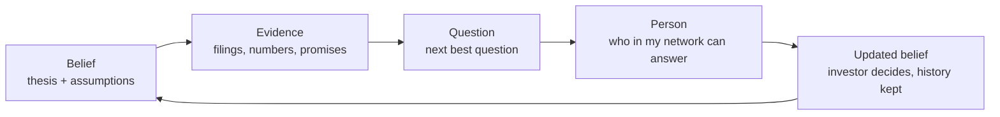
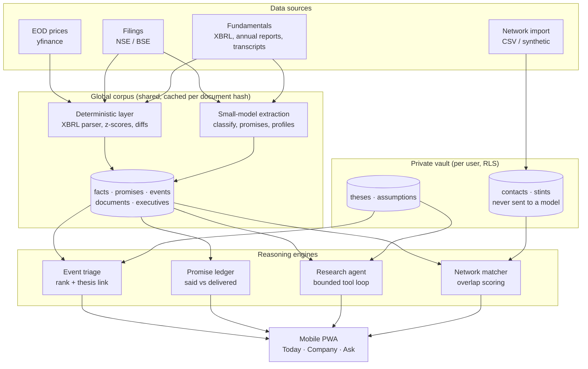
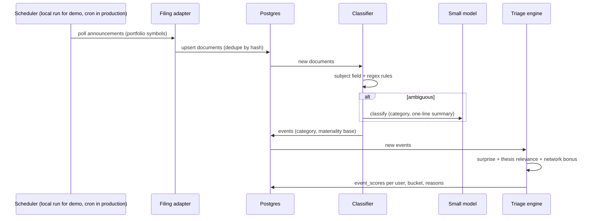
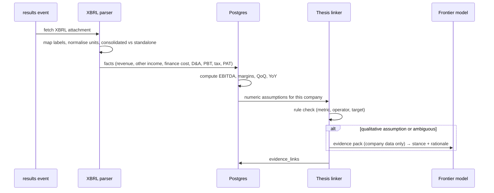
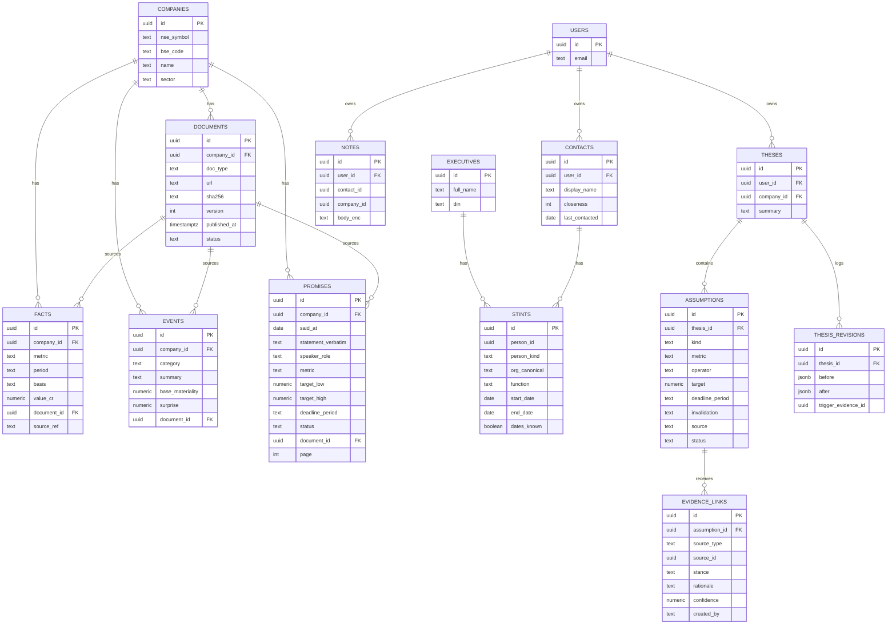
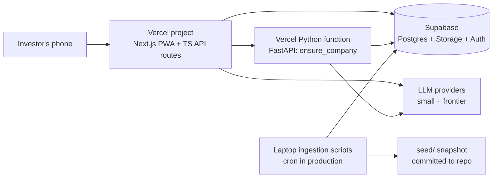

# FINN — a memory that argues back

> **Plan, not the current state.** Written before the build; what exists is in the README, and README §9 lists every difference.

> **FINN (Financial Investment Agent)** remembers why you own each stock, notices when primary filings contradict that belief, tells you the next question worth asking, and tells you who in your own network can answer it.

**Core loop:** `Belief → Evidence → Question → Person → Updated belief`

Built for the ENAM Founding AI Engineer Build Challenge (Push · Pull · Network, mobile-first).

> **v2 (after review).** Scope cut to a 24-hour critical path · lenders excluded from the portfolio · EBITDA formula fixed for exceptional items · volume/price alerts default to the brief's rules · "dates unknown" path for network overlaps · **no model ever sees the network** (pseudonymiser removed) · unseen-ticker path runs as a Vercel Python function · no login screen for graders · thesis split into *management's claims you're tracking* vs *your assumptions* · two additions: management credibility line and promise cross-check on results cards.

---

## Table of contents

1. [TL;DR for the developer](#1-tldr-for-the-developer)
2. [The problem and our point of view](#2-the-problem-and-our-point-of-view)
3. [Product](#3-product)
4. [Architecture](#4-architecture)
5. [Data model](#5-data-model)
6. [Intelligence layer — algorithms and contracts](#6-intelligence-layer--algorithms-and-contracts)
7. [AI usage and model routing](#7-ai-usage-and-model-routing)
8. [Trust layer — no hallucinated numbers](#8-trust-layer--no-hallucinated-numbers)
9. [Security and privacy](#9-security-and-privacy)
10. [Cost and efficiency](#10-cost-and-efficiency)
11. [Deployment](#11-deployment)
12. [Repository layout](#12-repository-layout)
13. [Local setup](#13-local-setup)
14. [API surface](#14-api-surface)
15. [Execution plan (24 hours)](#15-execution-plan-24-hours)
16. [Testing and evaluation](#16-testing-and-evaluation)
17. [Demo script](#17-demo-script-2-minutes)
18. [Risks and mitigations](#18-risks-and-mitigations)
19. [Deliberately left out / next](#19-deliberately-left-out--next)
20. [Submission checklist](#20-submission-checklist)

---

## 1. TL;DR for the developer

| Question | Answer |
|---|---|
| What is it? | A mobile PWA (Progressive Web App) with three screens — **Today**, **Company**, **Ask** — over a shared intelligence layer. |
| What is the central object? | A per-company **thesis** made of checkable **assumptions**. Every filing, number and management promise is linked to an assumption as evidence (network call notes join later, §19). |
| How do we avoid an empty app on first open? | Each company opens with **management's claims you're tracking** (Promise Ledger, extracted from the last four concall transcripts) plus at least one assumption **the investor wrote**. Prefilled claims are never presented as the investor's own thesis. |
| Where does the LLM touch numbers? | **Never.** Numbers come from XBRL (eXtensible Business Reporting Language) results filings and Python. LLMs write prose around injected numbers; a validator rejects any unsourced number (periods, dates and page numbers are allow-listed). |
| Where are agents used? | At most one bounded agent loop (free-text Ask), built only if time allows. Ask chips, and everything else, are deterministic or single-call pipelines. |
| How is the network kept private? | Per-user private vault (Postgres Row Level Security). Matching is SQL and explanations are templates, so **no model ever sees network data**. |
| Stack | Next.js PWA + a Python (FastAPI) function, both on Vercel · Supabase Postgres (+ Storage) · ingestion scripts run locally for the demo, committed as a snapshot (GitHub Actions cron is the production design) · small model for bulk extraction, frontier model for reasoning. |
| Portfolio | 15–20 **non-financial** NSE companies (lenders excluded: EBITDA is not meaningful for banks/NBFCs). Prefer companies that published July–September quarter results in the last two weeks. |
| Graders | No login screen: automatic anonymous demo sign-in; RLS still applies. |
| Cost target | ≈ ₹0 infra (free tiers); every LLM call logged to a table and the totals reported in the writeup. |

---

## 2. The problem and our point of view

The brief names two problems:

1. **Filtering, not aggregation.** A 15–20 stock portfolio produces dozens of exchange filings a day; most are routine paperwork.
2. **The dormant network.** Investors know people who could explain a development, but cannot see who knows what.

**Our point of view:** an investor does not want to know *what happened*. They want to know **whether their reason for owning the stock is still true** — and if not, what to ask and whom to ask. So FINN is organised around the investor's beliefs, not around a feed of data.

Three product convictions follow:

- **Finite, not infinite.** The day's brief ends. "3 things need you. Everything else is collapsed and counted." Nothing is hidden; noise is folded.
- **Verdict first, evidence on tap.** Every card states its conclusion, and every number is tappable to the exact source document and page.
- **People appear where they are useful.** There is no Network tab. Every card ends with one person and one question.

### Objections we expect, and how the product answers them

| Objection | Answer built into the product |
|---|---|
| "An investor's thesis isn't management's guidance. This is a guidance tracker in a thesis costume." | Prefilled items are labelled **Management's claims you're tracking**, separate from **Your assumptions**. Every thesis needs at least one investor-written assumption, and the demo shows the investor editing one. |
| "It's all canned data." | The unseen-ticker path (§4.4 P5) processes a company we did not pick, live, with a reduced fallback when documents are unavailable. |
| "The AI makes up numbers." | Numbers come only from XBRL and Python; each is tappable to its source; a validator blocks unsourced figures (§8). |

---

## 3. Product

### 3.1 The core loop



### 3.2 Concepts (shared vocabulary for the codebase)

| Concept | Definition | Example |
|---|---|---|
| **Thesis** | The investor's reason for owning a company. One per (user, company). Has two parts: *management's claims you're tracking* (prefilled from the ledger) and *your assumptions* (written by the investor, at least one required). | "Capacity-led growth with margin expansion." |
| **Assumption** | A single checkable claim inside a thesis. Either `numeric` (metric, operator, target, deadline) or `qualitative` (checked against cited passages). `source` is `management` or `investor`. | `ebitda_margin >= 18% by FY27-Q4` |
| **Credibility line** | Share of management's promises from the last four quarters that were delivered. | "Delivered 5 of 8 promises in the last 4 quarters." |
| **Invalidation condition** | What would make the investor reconsider. | "Two consecutive quarters of margin < 14%." |
| **Promise** | A forward-looking statement by management extracted from a transcript or report. | "Plant 2 commercial production in H2 FY26." |
| **Fact** | A deterministic number with period, unit and source. | Revenue Q2 FY27 = ₹2,628.5 cr (consolidated). |
| **Event** | A normalised happening: a filing, a price/volume anomaly, a promise status change. | `management_change`, `volume_spike`. |
| **Evidence link** | A connection between a fact/promise/event/note and an assumption, with a stance. | `contradicts` assumption #2 because margin fell 180 bps. |
| **Call sheet** | The network output: who to call, why (evidence of overlap), three questions, an opener. | "Call Priya — overlapped with the new CFO at X, 2016–19." |
| **Silence** | A previously repeated promise or topic that stops being mentioned. | Capex timeline discussed in 3 calls, absent in the latest one. |

### 3.3 Screens

#### Today — the finite brief (Push)

- **Header:** `62 filings · 3 touch your theses · ≈ 35 min of reading skipped (est.)` + time-window picker (24h default, 7d, custom) + **replay date** picker.
  - The time figure is an **estimate with a stated formula**, shown on tap: `collapsed × 0.5 min + worth_a_read × 1.5 min` (assumed reading times per filing, labelled as assumptions). If the formula can't be defended in the writeup, drop the figure.
- **Needs you (≤ 5 cards):** high-priority items, each a vertical stack:
  1. **What changed** — headline + deterministic numbers (Revenue/EBITDA/PBT/PAT, QoQ and YoY).
  2. **Promise cross-check** (results cards) — the relevant guidance next to the actual: "Guided 16–18% EBITDA margin · delivered 15.2%".
  3. **Which assumption it hits** — pill with stance: `supports` / `contradicts` / `neutral` / `insufficient evidence`.
  4. **Who to ask + one question** — one person chip with a one-line reason and one question; tap opens the call sheet.
  5. **Source** — filing link, page reference, epistemic label (see §8).
- **Worth a read:** one-line summaries next to the filing.
- **Collapsed:** `59 routine filings` — expandable, grouped by category.
- **Done state:** "That's everything that matters today."

#### Company — thesis, ledger, evidence (Pull)

- **Credibility line** at the top: "Delivered 5 of 8 promises in the last 4 quarters."
- **Thesis health strip:** two rows — *Management's claims you're tracking* and *Your assumptions* — one pill per item, coloured green / amber / red, with deadline countdown. Theses are seeded; **one assumption is editable** in the prototype.
- **Promise Ledger timeline:** each promise is a horizontal bar from *date said* to *deadline*, coloured by status (`delivered`, `on_track`, `revised`, `missed`, `unverifiable`; `dropped` only if extraction is clean). Tap → verbatim quote with transcript, quarter and speaker.
- **Financial snapshot:** last 8 quarters of Revenue, EBITDA margin, PAT, computed in Python.
- **Bull vs bear:** the strongest evidence-based case against the investor's thesis and the case for it, primary-source citations only (this absorbs "Challenge my thesis").
- **Next best question** and **people who could answer it**.

#### Ask — command bar (Pull + Network)

- Chips for fast, honest intents: `<TICKER> promises`, `<TICKER> bull vs bear`, `who knows <person or company>`, `experts in <theme>`.
- Free text falls back to the research agent **only if time allows**.
- **Works on any NSE ticker** with data available — not hard-wired to the demo set (§4.4 P5).

### 3.4 Key user flows (what the demo must show)

| # | Flow | Layers exercised |
|---|---|---|
| F1 | Quarterly results arrive → numbers parsed from XBRL → promise cross-check ("guided 16–18%, delivered 15.2%") → margin assumption contradicted → card in *Needs you* → call sheet suggests a contact who worked at a competitor. | Push + Memory + Network |
| F2 | New CFO appointed → brief profile parsed from the filing itself → career stints extracted → direct overlap or second-degree path shown with strength and reason; if the profile has no dates: "both worked at X; overlap not confirmed" (probable). | Push + Network |
| F3 | Volume > 2× its 20-day average (or price beyond ±X%) with **no** corresponding filing → "unexplained move" card. | Push |
| F4 | Investor opens Company → credibility line + Promise Ledger (4 quarters, said vs delivered) → edits one assumption → reads bull vs bear. | Pull + Memory |
| F5 | Investor picks an unseen ticker in Ask → Python function fetches documents on demand → ledger + snapshot, or the reduced version if documents are unavailable. | Pull (generalisation) |
| ~~F6~~ | *Next step, not in prototype:* after a call, a note becomes private evidence on an assumption. | Network → Memory |

### 3.5 Design principles

- Mobile-first, single column, thumb-reachable actions; max one accent colour reserved for "needs attention".
- Typography-led, newspaper front page rather than trading terminal; no price charts on the home screen.
- Every empty state is meaningful ("No filings touched your theses today").
- Every AI sentence carries an epistemic label and a source.
- Loading states show *what* is happening ("Reading Q2 transcript, page 7").

---

## 4. Architecture

### 4.1 Overview

The foundational decision is a split between a **Global corpus** (public data, processed once for everyone, cached by document hash) and a **Private vault** (theses and network — per user, isolated). Network data is used only by SQL and templates; **no model ever receives it**. The investor's thesis text may be sent to a model for qualitative evidence linking; it contains no third-party personal data.



### 4.2 Design principles

1. **Compute once, read many.** Anything derived from public data (parsed numbers, extracted promises, filing classification) is computed in batch and cached by content hash. The app is mostly reads, so it is fast and cheap.
2. **Deterministic before probabilistic.** Rules and Python first; a small model only where rules fail; a frontier model only where reasoning is required.
3. **Pipelines, not agents, by default.** One agent loop (Ask), bounded by step count and tool allow-list.
4. **Postgres as the single source of truth.** No graph database; second-degree network paths are SQL self-joins on `stints`.
5. **Append-only sources.** A corrected filing is a new document version, never an overwrite.
6. **Network data never reaches a model.** Matching is SQL, explanations and call-sheet openers are templates, and call-sheet questions are generated from company evidence only. This is simpler than pseudonymisation and avoids re-identification through coarse descriptors (e.g. "Treasury, BankX, 2016–19" can identify a real person).
7. **Snapshot first.** For the demo, ingestion runs from a laptop and the results are committed to `seed/`; scheduled cloud ingestion is the production design, not a demo dependency.

### 4.3 Data sources and adapters

Each source has its own adapter in `workers/adapters/` implementing `fetch() → list[RawDoc]` and `normalise(RawDoc) → records`.

| Source | Method | Cadence | Stored as | Notes / fallback |
|---|---|---|---|---|
| EOD price and volume | `yfinance` (`<SYMBOL>.NS`, fallback `.BO`) | Daily 18:30 IST (production); demo: local run | `prices` | Keep 1 year of history. |
| Corporate announcements | NSE corporate-announcements JSON endpoint (unofficial; requires session cookie from the homepage) | Every 30 min, 09:00–20:00 IST (production); demo: local run + snapshot | `documents` + `events` | **Verify in hour 1.** NSE and screener.in may block cloud servers (expectation, not verified) — so fetch from a laptop. Fallback: BSE announcements endpoint (inspect via browser dev tools). |
| Financial results | XBRL / iXBRL "Integrated Filing" attached to results announcements | On results filing | `facts` | Parse by tag/label map (see §6.1). Units are often ₹ lakh — normalise to ₹ crore. Quarterly results are due within 45 days of quarter end, so mid-November has fresh July–September results to replay. |
| Annual reports, concall transcripts | screener.in company page → *Documents* links (or company investor-relations site) | On demand (P5) + snapshot | `documents` (PDF in Storage) | Rate-limit, cache, respect terms of use. |
| Network profiles | Investor-supplied CSV + **synthetic** profiles for the demo; executive profiles from Regulation 30 appointment filings | On import / on filing | `contacts`, `stints`, `executives` | No scraping of restricted platforms. Writeup states this explicitly. |

> **Why the management-change card does not depend on LinkedIn:** under SEBI LODR (Listing Obligations and Disclosure Requirements) Regulation 30, an appointment disclosure includes a *brief profile* of the appointee, according to secondary summaries (verify against the regulation and SEBI's disclosure circular before quoting). Director appointments carry a DIN (Director Identification Number). The primary filing is the main source; external profile data is optional enrichment. Profiles may lack tenure dates — see the dates-unknown path in §6.5.

### 4.4 Pipelines

#### P1 — Filing ingest and triage (Push)



#### P2 — Results → facts → thesis check



#### P3 — Transcripts → Promise Ledger → drafted thesis

1. Download the last 4 transcripts per company (3 companies in the prototype); extract text with PyMuPDF, keep page numbers.
2. **One small-model call per transcript** (whole transcript in context — no chunking needed for typical lengths) with the `Promise` JSON schema (§6.3). Cache by document hash. Prototype scope: **numeric promises only**.
3. Match each promise against later `facts` → status.
4. Seed each thesis: top 3–5 promises become **Management's claims you're tracking** (`source = management`). Seed at least one investor-written assumption (`source = investor`); one assumption is editable in the UI.

#### P4 — Network matching

1. Import contacts CSV → `contacts` + `stints` (organisation, role, function, start, end — dates optional) + education.
2. Executives arrive from appointment filings (profile parsed by small model into `stints`; the model sees the **public filing**, not the investor's network). If the profile names employers without years, stints are stored with `dates_known = false`.
3. Organisation entity resolution: normalise names (strip "Ltd", "Limited", "Pvt"), alias table, `rapidfuzz` token-set ratio ≥ 90 → candidate; below that → no match.
4. Compute overlaps in SQL (§6.5) → `overlaps` materialised per user.

#### P5 — Unseen ticker, on demand (Vercel Python function)

Graders may point FINN at a company we did not pick, so this path must be solid.

| Step | What happens | Time budget |
|---|---|---|
| 1 | `POST /api/py/ensure_company {symbol}` validates the symbol against the NSE equity list (bundled CSV). | < 1 s |
| 2 | Prices via `yfinance` → snapshot table (always works if Yahoo has the ticker). | ~ 3 s |
| 3 | Latest results XBRL → `facts` → numbers table. | ~ 10 s |
| 4 | Up to 2 most recent transcripts → promise extraction (small model, parallel calls). | ~ 30–60 s |
| 5 | Cache everything by document hash; the second request is instant. | — |

- **Runtime:** FastAPI app deployed as a Vercel Python function in the same project; Vercel's Hobby plan allows up to 300 s per invocation. Stream progress lines to the UI ("Reading Q2 transcript…").
- **Fallback (reduced version):** if steps 3–4 fail (blocked source, scanned PDF, timeout at ~90 s), show prices + whatever numbers were parsed, with a clear "documents unavailable from this environment" note. Never a spinner that ends in an error.
- **Precompute:** the 3–5 research tickers are processed ahead of time and served from the snapshot.
- Keep the Python bundle slim (`fastapi`, `httpx`, `pymupdf`, `pydantic`, `yfinance`); check Vercel's bundle-size limit before deploying.

### 4.5 Scheduling summary

Production design (for the demo, these run once locally and the output is committed to `seed/`; the workflow file is kept in the repo):

| Job | Schedule (IST) | Runtime target |
|---|---|---|
| `ingest_filings` | every 30 min, 09:00–20:00 | < 2 min |
| `ingest_prices` + `detect_anomalies` | 18:30 daily | < 3 min |
| `parse_results` | triggered by results events | < 1 min per filing |
| `extract_promises` | weekly + on new transcript | < 30 s per transcript |
| `link_evidence` + `score_events` | after each ingest | < 1 min |
| `build_digest` | 07:30 daily + on demand | < 10 s |

---

## 5. Data model



Additional tables (omitted from the diagram for readability): `prices`, `event_scores (user_id, event_id, score, bucket, reasons[])`, `overlaps (user_id, contact_id, executive_id, strength, dates_confirmed, explanation)`, `llm_calls (model, task, tokens_in, tokens_out, cost_inr, cache_hit)`.

**Prototype vs design:** `notes`, `thesis_revisions` and `feedback` are part of the design and the migrations, but have no UI in the prototype (§19). Application-level encryption of `contacts` and `notes` is designed (§9) but not implemented.

**Rules that matter:**

- `facts.basis` ∈ {`consolidated`, `standalone`} — never mix them in one comparison.
- `companies.is_lender` excludes banks/NBFCs from the EBITDA results card (lenders are left out of the prototype portfolio; lender metrics are future work).
- `facts.value_cr` is always ₹ crore; the parser records the original unit in `source_ref`.
- Extracted claims (`facts`, `promises`) and AI interpretations (`evidence_links.rationale`) live in **separate tables**.
- `stints.person_kind` ∈ {`contact`, `executive`} lets one overlap query cover both sides.

---

## 6. Intelligence layer — algorithms and contracts

### 6.1 XBRL results parser (deterministic)

- Input: the XBRL / iXBRL attachment of a results announcement.
- Map line items through a config dictionary (`workers/parsers/xbrl_map.yaml`). Seed it from labels observed in real NSE Integrated Filings — e.g. *Revenue from operations*, *Other income*, *Finance costs*, *Depreciation, depletion and amortisation expense*, *Total profit before tax*, *Total tax expenses*, *Total profit (loss) for period*, *Share of profit (loss) of associates*. **Verify element names against an actual instance file before relying on them.**
- Normalise units (₹ lakh → ₹ crore: divide by 100).
- Our EBITDA definition (state it in the UI tooltip and writeup):

  `EBITDA = PBT + Finance costs + Depreciation & amortisation − Other income − Exceptional items − Share of profit of associates/JVs`

  - **Exceptional items:** a one-off gain is subtracted; a one-off loss (negative value) is added back. The sign follows how the filing reports it — check per filing.
  - **Share of associates/JVs:** subtract only if the filing's PBT line *includes* it. In one consolidated NSE filing we checked, the gap between segment-level profit and statement PBT exactly equalled the associates line, so placement varies — record per filing whether PBT is before or after it.
  - Show **PAT as reported** (no adjustment) and flag exceptional items on the card when present.
- **Lenders:** not supported. If `is_lender`, the results card is not built (lenders are out of the prototype portfolio).
- Output four headline metrics × {current quarter, previous quarter, same quarter last year} → QoQ and YoY in %, margins in basis points.
- Unit tests: three hand-verified filings (§16), at least one with an exceptional item.

### 6.2 Event triage and attention score

Each event gets a per-user score in [0, 1]. Every component produces a human-readable **reason chip**, so the score is never an unexplained number.

```
score = 0.35·M + 0.25·S + 0.30·T + 0.10·N      (clipped to [0,1])

M  base materiality of the category        (config table, e.g. results 0.9, management_change 0.8, unclassified 0.05)
S  surprise relative to the company's own history
     results:  sigmoid(max |z| of YoY growth / margin change vs last 8 quarters)
     price/vol: how far past the user's threshold, e.g. min((volume / avg20) / (2 × multiple), 1)
     category: 1 − frequency of this category for this company over the last 365 days
T  thesis relevance: 1.0 contradicts a numeric assumption · 0.7 any stance on a qualitative one · 0.4 company-level only · 0
N  network bonus: 1 if a contact with overlap strength ≥ 0.5 exists for an involved person/org
```

Buckets: `score ≥ 0.65` → **Needs you** · `0.35–0.65` → **Worth a read** (one-line summary) · `< 0.35` → **Collapsed**.

**Floor rules (no false negatives):** results, KMP (Key Managerial Personnel) changes, M&A, regulator orders, credit-rating downgrades and pledge increases are never placed below *Worth a read*.

Weights are a starting heuristic; report them as such. Per-user learning from swipe feedback is future work (§19).

**Alert thresholds — defaults follow the brief** (Settings, configurable):

| Alert | Default rule | Advanced option |
|---|---|---|
| Volume | volume > **2×** its 20-day average | z-score on log-volume over 60 days (sensitivity slider) |
| Price | daily move beyond **±X%** (default ±5%) | z-score on daily returns over 60 days |
| Filing type | always alert on results, M&A, management change, litigation | user picks categories |

### 6.3 Promise extraction contract

Small model, one call per transcript, JSON mode, schema-validated with Pydantic; invalid output → one retry → skip with log.

```json
{
  "promises": [
    {
      "statement_verbatim": "We expect EBITDA margins to be in the range of 16 to 18 percent for FY27.",
      "speaker_role": "CFO",
      "metric": "ebitda_margin",
      "target_low": 16.0,
      "target_high": 18.0,
      "unit": "percent",
      "deadline_period": "FY27",
      "hedged": true,
      "hedge_words": ["expect"],
      "page": 7
    }
  ]
}
```

`metric` enum: `revenue_growth`, `ebitda_margin`, `pat_growth`, `capex_amount`, `capacity`, `utilisation`, `net_debt`, `commissioning_date`, `order_book`, `other`.

### 6.4 Promise status logic

| Status | Rule |
|---|---|
| `delivered` | Numeric: actual within target range by deadline (from `facts`). Qualitative: later transcript/filing confirms (cited). |
| `on_track` | Deadline not reached; latest data trending to target. |
| `revised` | A later statement on the same metric changes the target or date. Show both quotes side by side. |
| `missed` | Deadline passed, actual outside range. |
| `dropped` (**silence**) | Mentioned in ≥ 2 transcripts, absent from the latest 2. Shown as "no update" — an observation, not an accusation. **Prototype: enable only if extraction quality is clean on the spot-check (§16); otherwise next step.** |
| `unverifiable` | No primary data can confirm or refute it. |

Matching a promise to later statements: same `metric` + same company → candidate; frontier model confirms only ambiguous pairs.

**Credibility line** (Company screen header) — one query over the ledger:

```sql
select count(*) filter (where status = 'delivered')                       as delivered,
       count(*) filter (where status in ('delivered','missed','revised')) as resolved
from promises
where company_id = $1
  and said_at >= now() - interval '12 months';
-- rendered as: "Delivered {delivered} of {resolved} promises in the last 4 quarters"
-- on_track and unverifiable promises are excluded from the denominator and shown separately
```

**Promise cross-check** (results cards) — for each headline metric on the card, fetch the most recent unresolved promise with the same `metric` and a deadline covering this period, and render `Guided {target_low}–{target_high}{unit} · delivered {actual}` with both sources tappable. If none exists, omit the line.

### 6.5 Network overlap strength

For a contact `c` and a person of interest `p` (executive, promoter, or company):

```
for each pair of stints at the same canonical organisation:
    if either stint has dates_known = false:
        s = 0.25, dates_confirmed = false      # "both worked at X; overlap not confirmed" (probable)
        continue
    overlap_years = max(0, min(end_c, end_p) − max(start_c, start_p))
    s = (1 − exp(−overlap_years / 2))          # saturating in duration
        × function_match                        # 1.0 same function, 0.6 adjacent, 0.3 different
        × size_factor                           # 1.0 small org, 0.5 very large org (less likely to know each other)
        × exp(−years_since_overlap / 10)        # recency decay
education: same institution and graduation years within ±2  → s = 0.4
strength(c, p) = max over all pairs

second-degree path (investor → contact → p):
    path_strength = (closeness_c / 5) × strength(c, p)
```

The **explanation is generated from a template**, not by an LLM:

- dates known: *"Both in Treasury at BankX, 2016–2019 (3 years overlap)."*
- dates unknown: *"Both worked at BankX; overlap not confirmed."* — labelled **probable**, ranked below confirmed overlaps.

Appointment filings often describe past employers without tenure years (our expectation, not verified across filings), so the dates-unknown path is the common case for executives and must look deliberate in the UI, not broken. Matches below 0.2 are not shown; matches from fuzzy name resolution are also labelled "probable".

Other network queries reuse the same tables:

- **Who should I call about company X?** Contacts with stints at X, its competitors, suppliers, customers (from a small hand-curated `org_relations` table for the demo).
- **Expertise map:** contacts tagged by theme (from CSV tags + functions of their stints).
- **Keep warm:** contacts with `last_contacted > 6 months` whose current/former employer has a *Needs you* event.
- **Who can challenge my thesis?** Contacts with expertise on the metric of the most contradicted assumption.

### 6.6 Thesis evidence linking

- Numeric assumptions: rule check in SQL (`metric`, `operator`, `target`) → stance with confidence 1.0, `created_by = rule`.
- Qualitative assumptions: frontier model receives an **evidence pack of company data only** (assumption text + up to 5 cited passages/facts; no network data) and returns `{stance, rationale, cited_ids[], confidence}`. Rationale must reference `cited_ids`; otherwise it is discarded.
- FINN **never edits a thesis**. It proposes; the investor accepts, edits, or dismisses. (Design: every change written to `thesis_revisions`; prototype: one editable assumption, no history UI.)

### 6.7 Next best question

Generated from gaps, not from free generation:

1. Find the assumption with the highest `contradicts` weight or `insufficient` stance.
2. Look up which metrics would resolve it (static map: e.g. *cash generation* → receivable days, cash from operations / EBITDA).
3. If the data exists → question points to it. If not → question becomes a **call-sheet question** routed to the best-matched contact.

### 6.8 Research agent (Ask)

- **Prototype scope:** Ask is chip-driven (each chip maps to a fixed pipeline, no agent). The free-text agent below is built only if time allows.
- Model: frontier model, tool use, **max 6 steps**, streaming.
- Tools: `get_facts(company, metrics, periods)`, `get_ledger(company)`, `search_docs(company, query, doc_types=[annual_report, transcript])`, `get_thesis(company)`. There is **no network tool**: people chips are attached to the answer by the app via SQL after the model finishes.
- Grounding rule in system prompt and enforced in code: **only primary documents**; no news, no broker notes, no model background knowledge. Any sentence without a `cited_id` is dropped before rendering.
- Unknown ticker: calls P5 (`ensure_company`) and caches the results.

---

## 7. AI usage and model routing

| Step | Handler | Why |
|---|---|---|
| Revenue / EBITDA / PBT / PAT, QoQ / YoY, margins | Python | Exactness; zero cost. |
| Price and volume anomalies | Python (brief's ratio rules by default; z-scores as an advanced option) | Deterministic and configurable. |
| Overlap strength, second-degree paths | SQL | Deterministic and explainable. |
| Promise status for numeric promises | SQL | Deterministic. |
| Announcement classification | Rules first → **small model** for ambiguous cases | Rules cover most filings for free. |
| One-line filing summaries (*Worth a read* bucket only) | **Small model** | Bulk, low reasoning. |
| Promise extraction, appointee profile → stints | **Small model**, JSON schema | Bulk extraction, cached once per document for all users. |
| Qualitative evidence linking, ambiguous promise matching | **Frontier model** | Real judgment, used only on top-k items. |
| Bull vs bear, research agent (if built) | **Frontier model** | Multi-document reasoning. |
| Card prose | Template + injected numbers; small model only for connective text | Keeps numbers out of the model's hands. |
| Anything involving the investor's network | **No model** — SQL + templates | Privacy by construction. |

**Configuration:** models are referenced only through `MODEL_SMALL` and `MODEL_LARGE` environment variables behind a single `llm.call(task, payload)` router that handles caching, retries, JSON validation and cost logging. The router rejects any payload containing fields from network tables (a simple key deny-list, tested in §16). Suggested defaults: a free-tier fast model (e.g. a Gemini Flash-class model) for `MODEL_SMALL`, a Claude Sonnet-class model for `MODEL_LARGE`. Check current free-tier limits before the demo.

**Prompt rules shared by all calls:**

- Inputs are delimited evidence packs with IDs; outputs must cite IDs.
- "If the evidence does not support a conclusion, return `insufficient`."
- No numbers may appear in output unless present in the evidence pack.

---

## 8. Trust layer — no hallucinated numbers

Every rendered statement carries one **epistemic label**:

| Label | Meaning | UI |
|---|---|---|
| `SAID` | Verbatim from a primary source | quote style + source link |
| `EXTRACTED` | Structured by a model from a cited source | small "extracted" tag |
| `CALCULATED` | Computed by FINN from extracted facts | formula on tap |
| `INFERRED` | Model interpretation of cited evidence | "FINN's read" tag + citations |
| `UNKNOWN` | Not determinable from primary data | explicit "unknown" |

**Number validator** (`app/lib/validate_numbers.ts` and `workers/llm/validate.py`):

1. Extract all numbers from model output (handles ₹, %, bps, cr, lakh, commas in Indian format).
2. **Skip allow-listed tokens** before checking: fiscal periods (`FY27`, `FY2026-27`, `Q2`, `Q2 FY27`, `H1`, `H2`, `9M`), calendar years (1990–2040), dates, month names with days, `page N`, list ordinals, and counts of cited items. Without this the validator would flag almost every sentence and fall back to the template.
3. Normalise the rest and compare against every number in the evidence pack (tolerance: rounding to displayed precision).
4. Any unmatched number → retry once with a stricter prompt → else fall back to the pure template.

**Source fidelity:** every fact stores `document_id` + page / XBRL element; every promise stores verbatim text + page. Tapping any number opens the source with the passage highlighted.

**Conflicts:** if two sources disagree (e.g. a results press release vs XBRL), show both and flag the discrepancy rather than picking one.

---

## 9. Security and privacy

| Concern | Design |
|---|---|
| Isolation | Supabase Auth + Postgres **Row Level Security** on every private table: `create policy own_rows on theses for all using (auth.uid() = user_id);` (same pattern for `contacts`, `stints` where `person_kind = 'contact'`, `notes`, `feedback`, `event_scores`, `overlaps`). |
| Graders' access | No login screen. The app signs each visitor in automatically as an anonymous demo user and copies the demo portfolio and synthetic network into that user's rows, so RLS is exercised for real while nobody types a password. Production uses normal sign-in. |
| Encryption | TLS in transit; Supabase encrypts storage at rest. **Designed, not built in the prototype:** application-level encryption of contact names and notes (`pgcrypto` or libsodium) with a per-user key held server-side. |
| LLM exposure | **No model ever sees the investor's network.** Matching is SQL; explanations, openers and people chips are templates added by the app after any model call. We chose this over pseudonymisation because coarse descriptors ("Treasury, BankX, 2016–19") can re-identify a person, and because it needs less code. Executives named in public filings are public data and may appear in model inputs. |
| Data minimisation | Store only professional history needed for matching (organisation, function, dates, education). No contact phone/email unless the investor adds it. |
| Retention | Derived artefacts (overlaps, scores) recomputed, not archived; raw notes kept until the user deletes them; one-click "delete contact" cascades to stints, overlaps and evidence links. |
| Consent | Contacts are supplied by the investor; in production, show a notice/consent workflow for imported contacts. India's DPDP (Digital Personal Data Protection) Rules, 2025 were notified in November 2025 with obligations phased in over roughly 18 months, according to secondary summaries; **check the official Gazette text before quoting dates in the writeup.** |
| Actions | FINN drafts outreach messages; the investor sends them. No autonomous external actions. |
| Profiles | Demo uses **synthetic** profiles (flagged `is_synthetic = true`) and profile sections of exchange filings. No scraping of platforms whose terms forbid it. |
| Secrets | API keys only in Vercel / GitHub Actions secrets; service-role key never shipped to the client. |

---

## 10. Cost and efficiency

- **Cache by content hash:** a filing or transcript is processed once for all users; network matching is the only per-user computation.
- **Rules before models:** classification rules handle most filings without an LLM call.
- **Whole-document extraction instead of RAG for transcripts:** one call per transcript, cached; retrieval (pgvector) only for long annual reports.
- **Top-k reasoning:** the frontier model only sees *Needs you* candidates and explicit user requests.
- **Precompute:** digests and ledgers are built in batch; the app reads.
- **Cost logging:** every LLM call is logged in `llm_calls` (model, task, tokens, ₹ cost, cache hit). Report totals in the writeup: total spend, calls by model, cache-hit rate, cost per company processed. An in-app cost meter is future work.

---

## 11. Deployment



| Component | Service | Why |
|---|---|---|
| Web app + TS API routes | Vercel (Hobby) | Zero-config Next.js, HTTPS; stream LLM responses. |
| Unseen-ticker processing | Vercel Python function (FastAPI) in the same project | Runs PyMuPDF and extraction on request; Hobby allows up to 300 s per invocation; no separate host and no idle sleep (unlike Render's free tier, which sleeps after 15 min idle and takes about a minute to wake). |
| Database, auth, file storage | Supabase (free tier) | Postgres with RLS, anonymous sign-in for the demo, Storage for PDFs. |
| Ingestion | Scripts run from a laptop; GitHub Actions workflow kept in the repo as the production design | Exchange and screener sites may block cloud servers; the demo must not depend on them. |
| Fallback data | `seed/` snapshot committed to the repo | The demo works even if live sources are blocked. |

---

## 12. Repository layout

```text
finn/
├── app/                        # Next.js PWA (TypeScript, Tailwind)
│   ├── (screens)/today/        # finite brief
│   ├── (screens)/company/[symbol]/
│   ├── (screens)/ask/
│   ├── api/                    # route handlers (§14)
│   ├── components/             # Card, AssumptionPill, LedgerTimeline, CallSheet, SourceSheet
│   └── lib/                    # supabase client, llm router (TS), templates, validate_numbers
├── api/                        # Vercel Python function: index.py (FastAPI) → ensure_company (P5),
│                               # imports workers/ parsers and pipelines; slim requirements.txt
├── workers/                    # Python batch pipelines (run locally for the demo)
│   ├── adapters/               # nse.py, bse.py, yf_prices.py, screener.py
│   ├── parsers/                # xbrl.py, xbrl_map.yaml, pdf_text.py
│   ├── pipelines/              # ingest_filings.py, parse_results.py, extract_promises.py,
│   │                           # link_evidence.py, score_events.py, build_digest.py, network.py
│   ├── llm/                    # router.py, schemas.py (Pydantic), prompts/, validate.py
│   └── tests/
├── db/
│   ├── migrations/             # SQL schema + RLS policies
│   └── seed.sql
├── seed/                       # portfolio.csv, network.csv, snapshot of filings/XBRL/transcripts
├── eval/                       # labelled announcements, promise spot-checks, eval.py
├── .github/workflows/          # ingest.yml (production cron design, not a demo dependency), ci.yml (tests)
├── docs/                       # architecture images, writeup draft, AI build history links
└── README.md
```

---

## 13. Local setup

```bash
# prerequisites: Node 20+, Python 3.11+, Supabase project (or supabase CLI for local)
git clone <repo> && cd finn

# database
supabase db push              # applies db/migrations, incl. RLS policies
psql "$DATABASE_URL" -f db/seed.sql

# workers
cd workers && python -m venv .venv && source .venv/bin/activate
pip install -r requirements.txt
python -m pipelines.ingest_prices --days 365
python -m pipelines.ingest_filings --since 30d       # falls back to seed/ snapshot if blocked
python -m pipelines.parse_results
python -m pipelines.extract_promises
python -m pipelines.network --import ../seed/network.csv
python -m pipelines.link_evidence && python -m pipelines.score_events
python -m pipelines.export_snapshot --out ../seed/       # commit this

# app (Next.js + the Python function under api/, run together)
cd .. && npm install && vercel dev
```

**Environment variables**

| Variable | Used by | Purpose |
|---|---|---|
| `SUPABASE_URL`, `SUPABASE_ANON_KEY` | app | Client access (RLS-enforced). |
| `SUPABASE_SERVICE_ROLE_KEY` | workers only | Batch writes to global tables. |
| `MODEL_SMALL`, `MODEL_LARGE` | both | Model routing. |
| `LLM_API_KEY_*` | both | Provider keys. |
| `VAULT_KEY` | app server | Reserved for application-level encryption (designed, not implemented). |
| `DEMO_REPLAY_DATE` | app | Default replay date for graders — set to a busy day in the recent results season. |

**Seed files**

- `seed/portfolio.csv` — `symbol, name, sector, size_bucket, is_lender` (15–20 rows; mix large/mid/small caps across 6+ **non-financial** sectors, e.g. IT services, specialty chemicals, consumer, capital goods, pharma, electronics manufacturing, auto components). `is_lender` is `false` for all rows. **Pick companies that published July–September results in the last two weeks**, so the replay date sits on real, recent data. At least 3 must have 4 quarters of transcripts for the ledger.
- `seed/research.csv` — 3–5 extra tickers for Ask demos (precomputed).
- `seed/network.csv` — synthetic, ~40 people:

  ```text
  contact_id, display_name, closeness(1-5), last_contacted, tags,
  org, role, function, start, end            # one row per stint; repeat contact_id
  ```

  Design it deliberately: at least 6 contacts overlapping portfolio companies, 2 overlapping an executive appointed in the demo window (one second-degree path with dates, one "overlap not confirmed" case), 3 at competitors/suppliers. Every row is marked synthetic. Leave `start`/`end` blank to exercise the dates-unknown path.

---

## 14. API surface

| Method | Route | Returns |
|---|---|---|
| `GET` | `/api/digest?from&to&replay` | Buckets (`needs_you`, `worth_a_read`, `collapsed_counts`), cards with reasons and promise cross-checks, reading-time estimate with its formula. |
| `GET` | `/api/company/:symbol` | Credibility line, thesis (management claims + investor assumptions), ledger, snapshot, next best question. |
| `PATCH` | `/api/company/:symbol/assumption/:id` | Edit the one editable assumption. |
| `POST` | `/api/company/:symbol/bullbear` | Streams for/against case with citations. |
| `POST` | `/api/ask` | Chip intents → fixed pipelines; free text → agent (if built). |
| `POST` | `/api/py/ensure_company` | **Python function (P5).** Streams progress; returns full or reduced company data. |
| `GET` | `/api/people/paths?target=` | Ranked contacts with strength, `dates_confirmed`, template explanation. |
| `GET` | `/api/callsheet?event_id=` | Person, reason, 3 questions (from company evidence), opener template. |
| `GET` | `/api/source/:document_id?page=` | Source viewer payload with highlight span. |

---

## 15. Execution plan (24 hours)

### 15.1 Scope

| Keep (critical path) | Simplify | Cut (writeup: next steps) |
|---|---|---|
| Today screen with the results card (F1), new-CFO card (F2) and unexplained-move card (F3) | Theses seeded and read-only; one editable assumption | Swipe feedback and per-category weights |
| Promise Ledger for 3 companies, numeric promises only, **plus credibility line and promise cross-check on results cards** | "Challenge my thesis" merged into a bull vs bear section | Thesis revision history UI, call notes (F6) |
| Direct overlaps plus one second-degree path, with call sheet and dates-unknown path | Ask screen uses chips; free text only if time allows | Silence detection (`dropped`), unless extraction is clean |
| Unseen-ticker path (P5) as a Vercel Python function, with reduced fallback | Cost logged to a table, reported in the writeup, no in-app meter | Scheduled cloud ingestion (keep the workflow file, run locally) |
| Seed snapshot, deployed link with anonymous sign-in, writeup | Evaluation: about 40 labelled filings, honestly reported | Application-level encryption (designed and described, not built) |

**Critical path:** snapshot data → results parsed for 3 companies → Today screen → network overlaps → Promise Ledger → deploy. Everything else comes **after a working deployed link exists**.

### 15.2 Blocks

Times are relative to start (T+0). Each block has an acceptance check; if a block overruns, apply its **cut line** and move on. Keep coding-agent sessions organised by block — the submission includes the AI build history.

| Block | Hours | Build | Acceptance check | Cut line if behind |
|---|---|---|---|---|
| **B0 Setup** | 0–1 | Repo, Supabase project, migrations + RLS, anonymous sign-in, Next.js + `api/index.py` skeleton **deployed to Vercel**. | Deployed URL opens on a phone without a login; RLS blocks a cross-user read in a test; Python function returns `ok`. | Skip RLS test; keep policies in migrations. |
| **B1 Snapshot** | 1–3 | From the laptop: portfolio of 15–20 non-financial companies that reported in the last two weeks; 1 year of prices; 30 days of filings; results XBRL; 4 transcripts × 3 companies; one recent appointment filing. Commit to `seed/`. | `seed/` loads into a fresh database with one command. | 15 companies, 2 weeks of filings. |
| **B2 Results + rules** | 3–5 | XBRL parser (exceptional items, associates, unit normalisation), EBITDA, QoQ/YoY for 3 companies; filing classifier rules; volume 2× / price ±X% alerts. | 3 hand-checked filings match to ₹0.1 crore; anomalies table populated. | Rules-only classifier; unparsed companies show "results filed" without numbers. |
| **B3 Today screen** | 5–9 | Digest API, scoring, floor rules, buckets with reasons, card anatomy, F1 + F3 cards, collapsed counts, replay date, done state, reading-time estimate with formula. | On a phone: ≤ 5 cards, every number tappable to source, collapsed count correct. | Drop the reading-time estimate. |
| **B4 Network** | 9–12 | Synthetic network CSV, org resolution, overlap SQL (with dates-unknown path), F2 card with profile from the filing, call sheet from templates. | F2 shows one confirmed second-degree path and one "overlap not confirmed" case; LLM log contains no network fields. | Direct overlaps only. |
| **B5 Ledger** | 12–15 | Promise extraction (numeric), status logic, credibility line, promise cross-check on results cards, seeded theses (management claims + one investor assumption, one editable). | ≥ 15 promises with verbatim quotes and pages; credibility line renders for 3 companies; F1 card shows a cross-check. | 2 companies; cross-check on one card. |
| **B6 Deploy checkpoint** | 15–16 | Full redeploy from a clean clone; phone test over mobile data. | F1–F4 work on the deployed link. | **Do not proceed until this passes.** |
| **B7 Unseen ticker** | 16–19 | P5 in the Python function: symbol validation, prices, XBRL, transcripts → promises, streaming progress, reduced fallback at ~90 s; precompute research tickers. | A ticker outside the snapshot returns full or reduced data on the deployed link without an error state. | Reduced version only (prices + numbers table). |
| **B8 Pull polish** | 19–21 | Bull vs bear with citations; Ask chips; number validator with allow-list; epistemic labels. | Validator tests pass; every bull/bear sentence has a citation. | Bull vs bear for the 3 ledger companies only. |
| **B9 Ship** | 21–24 | Evaluation (§16), cost totals from `llm_calls`, README update, writeup draft, export AI sessions, final phone test. | Fresh-device test passes; all checklist items ticked except sending. | — |

---

## 16. Testing and evaluation

| Test | Method | Report in README |
|---|---|---|
| XBRL parser | Unit tests on 3 filings with hand-verified numbers, at least one with an exceptional item; unit-conversion tests (lakh/crore); consolidated vs standalone separation | Pass/fail |
| Number validator | Fuzz tests with Indian number formats (`1,14,491.87`, `180 bps`) **and** allow-listed tokens (`FY27`, `Q2 FY27`, `H2`, `2016`, `page 7`) that must not be flagged | Pass/fail |
| Triage quality | Hand-label about 40 announcements as *material / not*; compute precision and recall of the *Needs you* + *Worth a read* buckets | Precision, recall, confusion table, with the sample size stated |
| Promise extraction | Spot-check 20 extracted promises against transcripts (quote, metric, deadline correct?) | Accuracy per field; decides whether `dropped` ships |
| Overlap scoring | Unit tests on synthetic stints (no overlap, partial, full, education, dates unknown) | Pass/fail |
| Privacy | Assert that no logged LLM payload contains fields from `contacts`, `stints` (contact rows) or `overlaps`; RLS cross-user read test | Pass/fail |
| Unseen ticker | Run P5 on 3 tickers not in the snapshot, from the deployed link | Full / reduced / failed per ticker, with timings |
| Reproducibility | Fixed random seed for synthetic network generation; snapshot versioned | — |

**Honest reporting:** with about 40 labels, do not tune weights and report on the same items. Either keep the starting weights and report on all 40, or tune on 20 and report on the other 20 — and say which.

---

## 17. Demo script (2 minutes)

1. **Open the link on a phone** — no login → Today: "58 filings · 3 touch your theses".
2. **Card 1 — results (F1):** revenue up, EBITDA margin down 180 bps YoY → "Guided 16–18% · delivered 15.2%" → *contradicts* the investor's margin assumption → one person and one question at the bottom of the card.
3. **Card 2 — new CFO (F2):** profile from the filing → "You know Rahul, who overlapped with her at X for 3 years in Finance" → and an honest "both worked at Y; overlap not confirmed".
4. **Card 3 — unexplained move (F3):** volume 2.6× its 20-day average, no filing.
5. **Company screen (F4):** "Delivered 5 of 8 promises in the last 4 quarters" → ledger → tap a bar → verbatim quote, page 7 → **edit one assumption** → bull vs bear.
6. **Ask an unseen ticker (F5)** → live progress → ledger, or the reduced version.
7. Close with: "Numbers come from filings, not the model. And no model ever sees your network."

---

## 18. Risks and mitigations

| Risk | Likelihood | Mitigation |
|---|---|---|
| NSE / screener.in block cloud servers | High (expected, not verified) | Ingest from a laptop; commit snapshot; BSE fallback; P5 has a reduced fallback. |
| P5 exceeds time or fails on a grader's ticker | Medium | 300 s Hobby limit with a ~90 s internal cut-off; stream progress; reduced version instead of an error. |
| Python bundle too large for Vercel | Low–medium | Slim dependencies; check size in B0. |
| XBRL labels/units differ across companies | Medium | Config-driven label map; unit detection; flag unknown labels instead of guessing. |
| EBITDA distorted by exceptional items or associates | Medium | Formula in §6.1; flag exceptional items on the card; unit test with an exceptional item. |
| Transcript PDFs are scanned images | Low–medium | Detect empty text layer; choose other companies for the ledger; OCR is next. |
| Appointment profile has no dates | High | Dates-unknown path, labelled probable. |
| LLM free-tier rate limits during grading | Medium | Precompute all but P5 and bull vs bear for new tickers; cache by document hash. |
| Hallucinated numbers or citations | Medium | Number validator with allow-list, cited-ID enforcement, template fallback. |
| "Guidance tracker in a thesis costume" objection | High | Split labels, mandatory investor assumption, edit shown in the demo. |
| Demo opened on a quiet day | High | `DEMO_REPLAY_DATE` on a busy results day. |
| Over-scoping | High | §15.1 cut table; deploy checkpoint B6 before any extras. |

---

## 19. Deliberately left out / next

| Left out | Why | Next step |
|---|---|---|
| Banks and NBFCs | EBITDA is not meaningful for lenders | Lender results card: NII (net interest income), PPOP (pre-provision operating profit), PAT, with its own XBRL label map. |
| News / media intelligence | Outside the brief's four sources; paywalls and terms of use; Pull must remain primary-only | Separate Push-only stream with verification states (official / corroborated / single-source). |
| Swipe feedback and learned weights | Time | Per-user, per-category multipliers in [0.5, 1.5] learned from feedback. |
| Thesis revision history, call notes (F6) | Time | `thesis_revisions` and `notes` tables already in the schema. |
| Silence detection (`dropped`) | Depends on extraction quality | Ship once the spot-check passes. |
| Scheduled cloud ingestion | Sources may block cloud servers | Run the workflow from a self-hosted runner or an Indian-region VM. |
| Application-level encryption | Time | `pgcrypto`/libsodium per-user keys for contacts and notes. |
| In-app cost meter | Time | Read from `llm_calls`. |
| Credibility that follows a person | Needs guidance history per executive across companies | Link `executives` across companies by DIN. |
| Annual-report diffs | Time | Year-over-year section diffs of risk factors, contingent liabilities, related-party transactions. |
| Meeting-prep trigger, voice | Integrations | Calendar-triggered brief; speech-to-text call notes. |

---

## 20. Submission checklist

- [ ] Deployed link opens on a phone over mobile data, **no login**
- [ ] Public GitHub repo with this README and the diagrams
- [ ] `seed/` snapshot so the demo runs regardless of live sources
- [ ] Unseen-ticker test results (§16) in the README
- [ ] Evaluation results (§16) with sample sizes stated
- [ ] LLM cost totals from `llm_calls` in the writeup
- [ ] AI build history: exported coding-agent and LLM sessions, organised by block, including moments where output was rejected or rewritten
- [ ] Writeup: what was built, key decisions and trade-offs, architecture (pipelines, security and privacy, LLMs and agents, cloud), what was left out, what is next
- [ ] Clear statement that network profiles are synthetic and how it would be done for real
- [ ] Regulation 30 and DPDP statements checked against official text, or worded as secondary-source summaries
- [ ] **Send the email yourself** to the address in the brief, with the subject line exactly as specified there

---

### References

- ENAM, *FINN: Financial Investment Agent — Founding AI Engineer Build Challenge* and companion *Reference: Announcement Categories & Financial Glossary* (provided PDFs).
- SEBI LODR Regulation 30 disclosure requirements for changes in directors/KMP, summarised in: [LegalMantra](https://legalmantra.net/blog-detail/What-are-the-disclosures-applicable-for-Change-in-Directors-Key-Managerial-Personnel-of-Director-in-a-Listed-Entity) and [KPMG First Notes, Aug 2023](https://assets.kpmg.com/content/dam/kpmg/in/pdf/2023/08/firstnotes-sebi-amends-disclosure-requirements-of-material-events-or-information.pdf). Verify against the regulation text before quoting.
- Vercel function duration limits (Hobby: up to 300 s): [Vercel docs](https://vercel.com/docs/functions/configuring-functions/duration). Render free-tier spin-down: [Render docs](https://render.com/docs/free).
- NSE XBRL information and Integrated Filings: [nseindia.com/companies-listing/xbrl-information](https://www.nseindia.com/companies-listing/xbrl-information).
- DPDP Rules, 2025 phased timeline: [Legal500 / Saga Legal](https://www.legal500.com/firms/237811-saga-legal/c-india/news-and-developments/the-privacy-timer-starts-now-analysing-the-dpdp-rules-and-its-18-month-countdown) (secondary summary; check the Gazette notification).
- Cohen, Malloy & Nguyen, "Lazy Prices", *Journal of Finance* 75(3), 2020 — motivation for the annual-report diff feature (future work): [NBER w25084](https://www.nber.org/papers/w25084).
